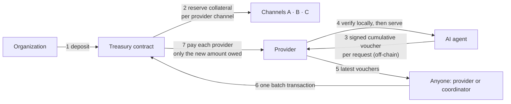

# AgentBatch

**Shared treasury and batch settlement infrastructure for AI-agent payments on Stellar.**

AgentBatch lets an organization fund **one** Soroban treasury and use it to pay
**many** independent services (model inference, search, data, tools, other agents)
on behalf of its AI agents. Agents pay per request with signed off-chain vouchers,
providers check each payment locally before serving, and the claims of several
providers are settled together in **one Stellar transaction**.

> **Status:** Stellar Testnet proof of concept using a synthetic test asset (AUSD),
> not USDC. It is internally reviewed and covered by an automated test suite, but has **not had an
> independent external security audit**. Do not use it with assets of value.

## Why AgentBatch

AI agents buy many small services, often thousands of times a day. Paying every
request on-chain is slow and costly. Payment channels avoid that, but a channel is
normally a separately funded contract for one payer–provider pair, so an
organization working with dozens of providers splits its money across dozens of
channels and manages each one separately.

AgentBatch keeps the security of cumulative payment channels and removes the
fragmentation: one treasury funds all channels, each channel's collateral stays
reserved for its own provider, and settlement is batched.

## How it works



| Mechanism | What it means |
|---|---|
| **Shared treasury** | One contract per organization and payment asset holds the deposit and all accounting. |
| **Virtual channels** | A channel is a record inside the treasury, not a separate contract. It binds one provider address and one delegated agent key, and reserves a fixed allocation. |
| **Cumulative vouchers** | The agent signs "this provider may claim up to *X* in total on this channel". Each new voucher replaces the last; the provider verifies it locally, with no transaction per request. |
| **Batch settlement** | Anyone can submit the latest vouchers of up to four channels in one transaction. Each provider is paid `voucher − already redeemed`, and the batch is all-or-nothing. |

## The financial guarantee

The treasury tracks deposits, withdrawals, payouts, **available** funds and
**reserved** funds. Opening a channel moves its allocation from available to
reserved. Only available funds can ever be withdrawn, and reserved funds can only
be paid to the channel's own provider. A provider never accepts a voucher above its
channel's allocation. So **every voucher a provider has accepted is backed by tokens
already held in the treasury**, even if the owner withdraws everything it is allowed
to and other channels are fully spent. The only exceptions are outside the
contract's control: the asset issuer freezing a provider or clawing back the
treasury's balance.

The contract maintains, and the test suite asserts after every operation:

```text
deposited − paid − withdrawn = available + reserved
reserved  = Σ (allocation − redeemed)      over all channels
paid      = Σ redeemed
available = deposited − withdrawn − Σ allocation
token balance ≥ available + reserved
```

Replays pay nothing, because a voucher at or below the amount already redeemed is
rejected. The full model, including how vouchers held off-chain relate to
allocations and withdrawable funds, is in
[ARCHITECTURE §6](docs/ARCHITECTURE.md#6-treasury-and-channel-data-model-and-accounting).

## What exists and what is planned

| Implemented in this repository | Planned |
|---|---|
| Soroban contract `AgentBatchPoC`: one treasury per deployment, reserved channels, strict Ed25519 voucher verification, atomic settlement of 1–4 channels, incremental redemption, withdrawal of unallocated funds | Aggregate per-agent and per-provider budgets |
| TypeScript voucher library: byte-identical encoding, agent signing, provider-side verification, fail-closed voucher stores | Channel closure with a protected claim window, top-ups, signer replacement |
| Testnet runner: deploys disposable contracts and runs a three-provider demonstration | Durable signer and provider services, settlement coordinator, TTL keeper |
| Evidence verifier: checks archived transactions offline or against Testnet RPC | Indexer and API, Treasury Console, production SDK |
| Offline example of the payment flow | MPP and x402 adapters, Mainnet deployment |

The complete target design is in [docs/ARCHITECTURE.md](docs/ARCHITECTURE.md), and
every remaining item, with its priority and acceptance criteria, is in
[docs/FUTURE_WORK.md](docs/FUTURE_WORK.md).

## Demonstrated on Stellar Testnet

The committed archive records one complete run:

| Step | Result |
|---|---|
| Shared funding | One deposit of 100 AUSD into a single treasury contract |
| Independent channels | Three channels of 40 / 35 / 15 AUSD reserved inside that contract, 10 AUSD left available |
| Off-chain payments | 11 simulated paid requests verified by the providers, with no transactions submitted |
| Batch settlement | [One transaction](https://stellar.expert/explorer/testnet/tx/cf74ff58182bfd6db9be07d3b0601191bd58f4b759172422a52d53d4b82dd2c2) paid 12 / 8 / 5 AUSD to three providers |
| Incremental redemption | [A later cumulative voucher for 17](https://stellar.expert/explorer/testnet/tx/8b707294e93897e3a5ca226ecc7de0767cd9bef299855a5ec6e6d3838a18f7e6) paid only the extra 5 |
| Attacks submitted on-chain | Voucher above its channel's allocation, voucher replayed on another provider's channel and a [replayed batch](https://stellar.expert/explorer/testnet/tx/ee90afe38c405ac89aaf8cff0e932c007b84137b3a257bcbf41d18dffc75fa8f) all failed with the expected errors |
| Withdrawal | The owner withdrew exactly the 10 unallocated AUSD; reserved funds stayed untouched |
| Cost | One three-provider batch cost 22,294 stroops in fees, against 32,898 for three separate settlements (32.23% less, for this workload only) |

The archive contains 22 transactions (19 successful, 3 intentionally failed) with
their raw XDR: [manifest](deployments/testnet/manifest.json),
[evidence](deployments/testnet/evidence.json),
[measurements](docs/benchmarks/testnet-resources.json). The demo treasury is
[`CCNFYVZN…KMGJ`](https://stellar.expert/explorer/testnet/contract/CCNFYVZNOP7TK4BK4PMF36FU7UXC4SN4G6LQWTQ3CBLAR4EBDT4YKMGJ).
The optimized WASM is 17,001 bytes with SHA-256
`ab37537a6f65418bc968c4133ca9e9700d3980fd5a5915967e5914ce53068a04`; CI rebuilds it
from source and requires that hash.

A second reproduction with the reorganized tooling used fresh accounts and
contracts; its records are not committed, but its transactions are public:
[treasury](https://stellar.expert/explorer/testnet/contract/CAG47O2YYEFW4RR6RXUCUN4H3JMCDWSXFNSKVSAQJ4PSFUZ5PS7EAXNF),
[deposit](https://stellar.expert/explorer/testnet/tx/454dbd2589fc87a1463af2ada09fdac11b9a1c814fe7eadb60a1d881742c1d43),
[batch](https://stellar.expert/explorer/testnet/tx/106aeba342fb9b120056dda94447509241067a0b441a374a37bbdc1f60c6cd5f),
[incremental redemption](https://stellar.expert/explorer/testnet/tx/7cc412ada3bfdebb8ad2dd0045760acd48ca578441748f89ddd1583bcdc59666),
[above-allocation rejection](https://stellar.expert/explorer/testnet/tx/8d275765678190f4dceed7f244b46cc5b88d2105338112b1d5abc835fb25e5c3),
[cross-channel rejection](https://stellar.expert/explorer/testnet/tx/9ea31ea897369f2e7d0630be1bfc9c24d27694db8203e029ec32ba68689b8a4e),
[replay rejection](https://stellar.expert/explorer/testnet/tx/1ddc4f1d0c7ce779e458a5c03b242970593e1c240bfd2ee17f17073f68f0cacf),
[withdrawal](https://stellar.expert/explorer/testnet/tx/e6402300b428add6bc8535920baec4740edc195cc730b2ea092dcc6a389017b3).

The providers and agents in these runs are simulated; they are not production traffic.

## Quick start

Requirements: Rust 1.94.1 with the `wasm32v1-none` target (pinned in
`rust-toolchain.toml`), Stellar CLI 26.0.0, Node ≥ 22.12 and pnpm 10.19.0.

```bash
# Install exact dependencies, build, and run every offline check
pnpm install --frozen-lockfile
pnpm build
pnpm check

# See the payment flow without network access
pnpm example:offline

# Deploy disposable accounts and contracts and run the Testnet demonstration
pnpm testnet:demo

# Check archived evidence offline, or reconcile it with Testnet RPC
pnpm evidence:check
pnpm evidence:verify
```

`pnpm check` runs formatting, Clippy, type checking, the optimized-WASM contract
tests, all TypeScript suites, the archive checks and the offline example. On
machines with little memory, see [CONTRIBUTING.md](CONTRIBUTING.md) for
lower-parallelism settings.

Each Testnet run writes a new `deployments/testnet/runs/<run-id>/` directory and
uses fresh disposable keys under `.secrets/testnet/`; provider state lives under
`.state/testnet/<run-id>/`. Both private directories are gitignored. See the
[Testnet tooling](tools/testnet/README.md) and the
[evidence verifier](tools/evidence/README.md).

## Contract interface

| Function | Who | Effect |
|---|---|---|
| `__constructor(owner, token)` | owner | Binds the owner and the 7-decimal payment token permanently |
| `deposit(amount)` | owner | Adds funds as available |
| `open_channel(provider, signer_key, allocation)` | owner | Reserves `allocation` for one provider and one agent key |
| `redeem_batch(vouchers)` | anyone | Settles 1–4 channels; payouts go only to the stored providers |
| `withdraw_available(amount)` | owner | Withdraws available funds; reserved funds can never be withdrawn |
| `get_treasury()`, `get_channel(id)`, `voucher_message(id, amount)` | anyone | Read-only views |

Details: [contract architecture](docs/ARCHITECTURE.md#4-on-chain-component-architecture)
and [voucher format](docs/voucher-format.md).

## Repository layout

```text
contracts/agentbatch-poc/    Soroban contract with native and compiled-WASM tests
packages/voucher/            Voucher encoding, signing, verification and stores
tools/testnet/               Testnet deployment, provider simulation, settlement, benchmarks
tools/evidence/              Offline archive checks and read-only RPC verification
examples/offline-payments/   Runnable local signing and verification example
test-vectors/                Shared Rust/TypeScript compatibility fixtures
deployments/testnet/         Committed Testnet evidence
docs/                        Architecture, protocol, security and operations documentation
scripts/                     Thin command wrappers
.github/                     CI and contribution templates
```

## Documentation

| Read this | To |
|---|---|
| [Architecture](docs/ARCHITECTURE.md) | Understand the complete platform: components, accounting model, workflows, trust boundaries, implementation status |
| [Vision](docs/vision.md) | See the product goals, use cases and roadmap |
| [Future work](docs/FUTURE_WORK.md) | Find every planned capability and open finding, with acceptance criteria |
| [Production specification](docs/production-specification.md) | Read the detailed normative requirements behind the architecture |
| [Voucher format](docs/voucher-format.md) | Implement or verify vouchers byte for byte |
| [Accounting invariants](docs/accounting-invariants.md) | Check the PoC's collateral and payout rules |
| [Security assumptions](docs/security-assumptions.md) | Review the threat model and known limits |
| [SDK reference](docs/sdk.md) | Use the voucher library and see the planned SDK |
| [Benchmarks](docs/benchmarks.md) | Inspect measured fees and resources |
| [Decision records](docs/decisions.md) | Understand the main design trade-offs |
| [Operations](docs/production-operations.md) and [maintenance](docs/maintenance.md) | Plan production operation, governance and releases |
| [Repository review](docs/repository-review.md), [review findings](docs/review-findings.md), [earlier review](docs/audit-report.md), [specification review](docs/poc-spec-review.md) | Trace internal reviews, their findings and verification |

## Relationship to the Stellar ecosystem

AgentBatch builds on existing Stellar payment work. Its voucher encoding follows
the commitment convention of Stellar's
[one-way channel](https://github.com/stellar-experimental/one-way-channel) and the
[Stellar MPP SDK](https://github.com/stellar/stellar-mpp-sdk), extended with the
channel, owner, provider and signer bindings that a shared treasury needs. It is
complementary to the [x402 `exact` scheme](https://github.com/x402-foundation/x402/blob/main/specs/schemes/exact/scheme_exact_stellar.md),
which settles each payment on-chain. AgentBatch vouchers are not interchangeable
with those formats; adapters for MPP and x402 are planned work.

## Contributing, security and license

- [Contributing](CONTRIBUTING.md) and [code of conduct](CODE_OF_CONDUCT.md)
- [Security policy](SECURITY.md): report vulnerabilities privately, not in public issues
- License: [Apache-2.0](LICENSE)
