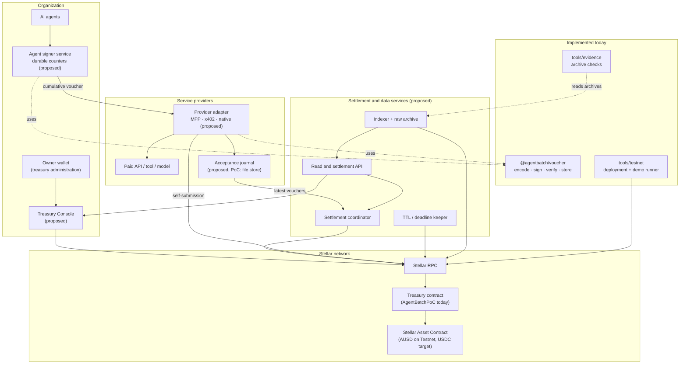
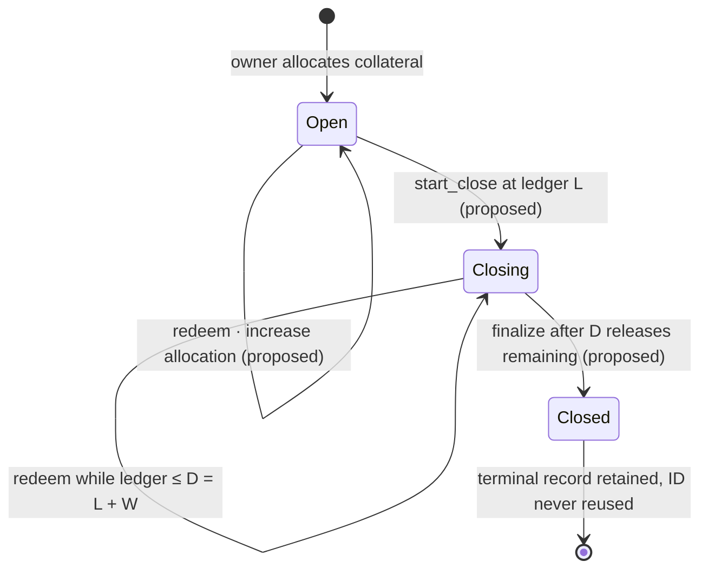
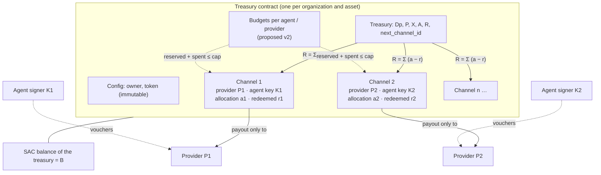
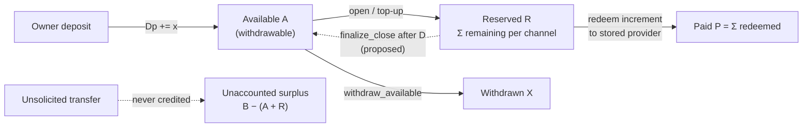
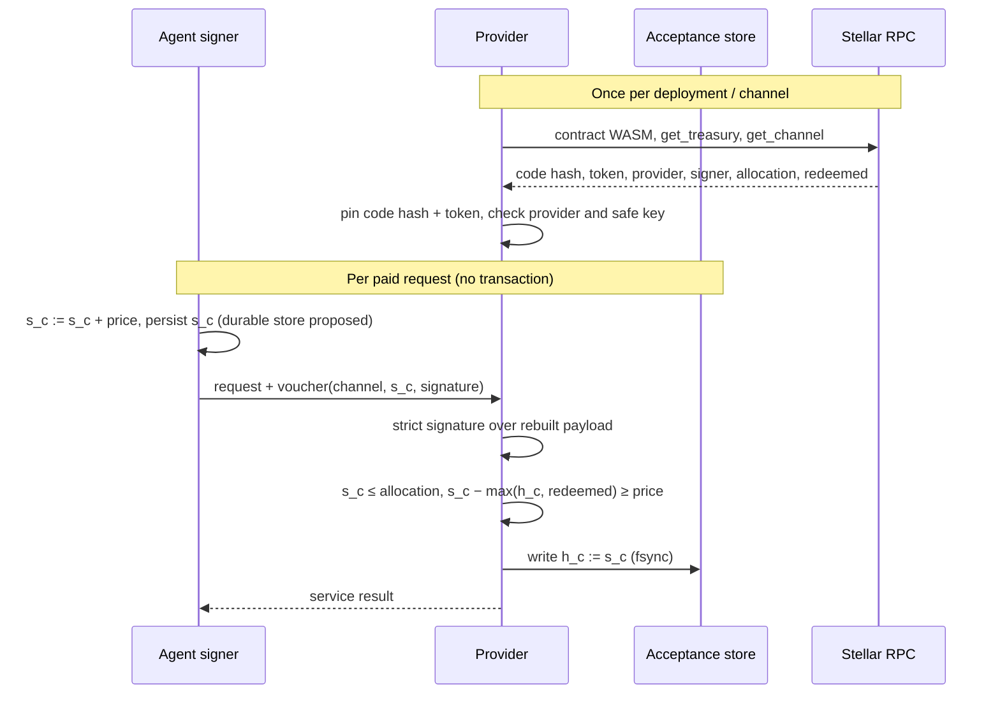
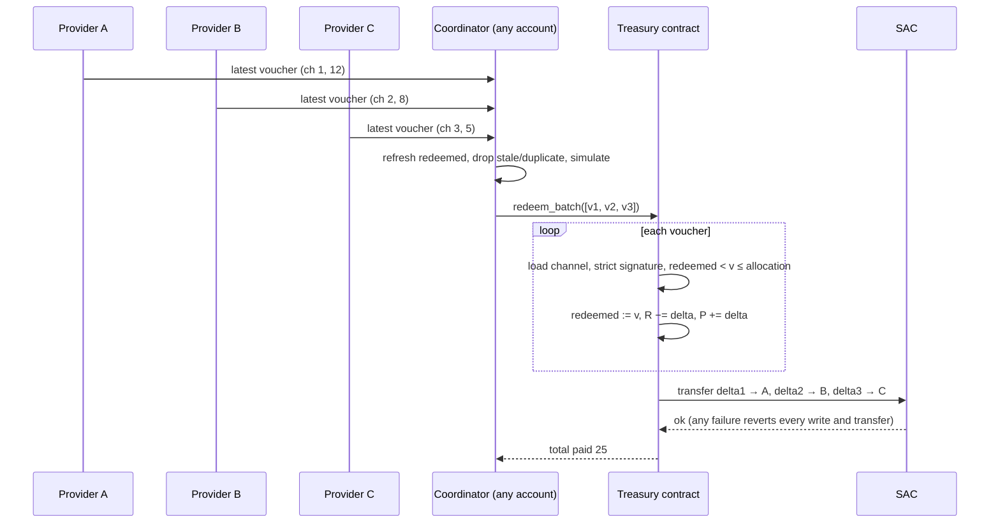
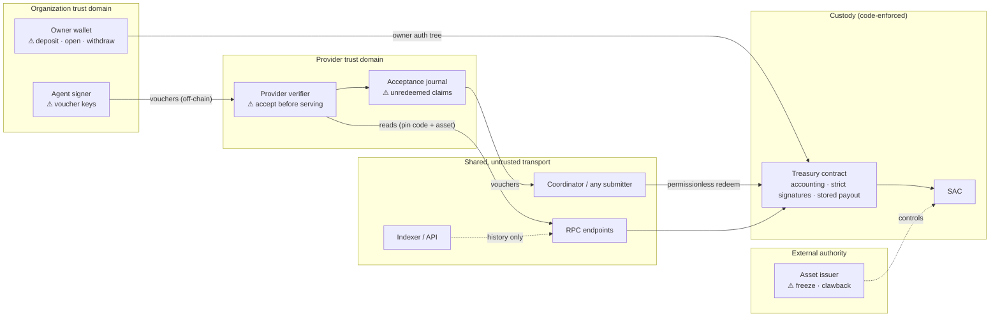
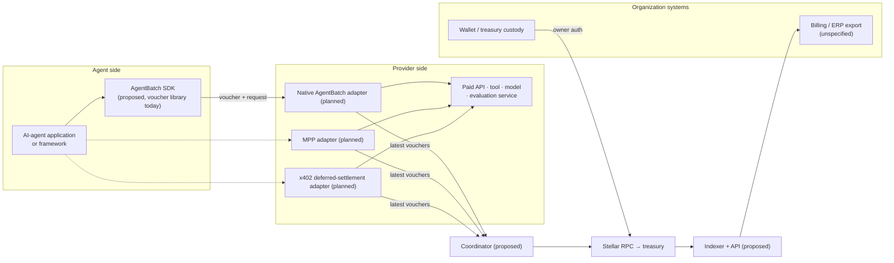

# AgentBatch architecture

AgentBatch is shared-treasury and batch-settlement infrastructure for paying
independent services from AI-agent workloads on Stellar. This document describes
the **complete platform**: what exists today, the target design, how the parts
interact, the accounting that protects funds, and the trust boundaries around it.

> **Implementation boundary.** The repository contains a Stellar Testnet proof of
> concept (one Soroban contract, a TypeScript voucher library, Testnet and
> evidence tooling, and an offline example). Every other component in this
> document is **proposed**. Each section marks status explicitly, and
> [§13](#13-implementation-status) maps every component to source code or to its
> backlog item in [FUTURE_WORK.md](FUTURE_WORK.md). Nothing here is a deployed
> production service, an audited release, or a Mainnet deployment.

Detailed normative requirements (exact proposed ABI, transaction state machine,
storage restoration, indexer schemas, service-request protocol, Console behavior)
live in the [production specification](production-specification.md). This
document summarizes them and links to the owning section rather than repeating them.

Contents:
[1 Overview](#1-system-overview) ·
[2 Principles](#2-architecture-principles) ·
[3 System](#3-complete-system-architecture) ·
[4 On-chain](#4-on-chain-component-architecture) ·
[5 Off-chain](#5-off-chain-component-architecture) ·
[6 Data model and accounting](#6-treasury-and-channel-data-model-and-accounting) ·
[7 Vouchers](#7-voucher-protocol) ·
[8 Workflows](#8-payment-and-settlement-workflows) ·
[9 Security](#9-security-architecture) ·
[10 Integration](#10-integration-architecture) ·
[11 Operations](#11-deployment-and-operations) ·
[12 Scalability](#12-scalability-and-performance) ·
[13 Status](#13-implementation-status) ·
[14 Decisions](#14-architecture-decisions-and-trade-offs) ·
[15 Limitations](#15-limitations-and-future-extensions)

---

## 1. System overview

An organization runs AI agents that consume paid services: model inference,
search, data retrieval, tool execution, evaluation and other agents. Each request
is small and frequent. Paying every request on-chain is slow and costly, and
funding a separate payment channel for every agent–provider pair fragments
liquidity and operations.

AgentBatch combines four mechanisms:

| Mechanism | What it does |
|---|---|
| **Organization treasury** | One Soroban contract per organization and payment asset holds deposited funds and the accounting for all of that organization's channels. |
| **Provider channels** | Records inside the treasury, each reserving collateral exclusively for one provider and one delegated agent key. A channel is not a separate contract or a Stellar account. |
| **Cumulative vouchers** | The agent signs, off-chain, "provider may claim up to *X* in total on channel *c*". Each new voucher replaces the previous one. Providers verify locally before serving a request; no transaction per request. |
| **Batch settlement** | Anyone submits the latest vouchers for several channels in one transaction. The contract pays each stored provider the difference between the voucher and what was already redeemed. |

Principal use cases: high-frequency inference billing; one agent buying from
several APIs; many agents of one organization under per-agent and per-provider
limits (target design); agent-to-agent services; tool marketplaces that settle
many provider relationships.

The relationship that makes this safe is simple to state. A provider never
accepts a voucher larger than its channel's allocation, and that allocation is
reserved in the treasury when the channel opens and cannot be withdrawn while it
backs a claim. Every voucher a provider accepts is therefore covered by tokens
already held by the contract. [§6](#6-treasury-and-channel-data-model-and-accounting)
states this precisely.

## 2. Architecture principles

| Principle | How it is realized | Status |
|---|---|---|
| Shared treasury, isolated allocations | One deposit funds many channels; each channel's `allocation` is moved from `available` to `total_reserved` and can only be paid to that channel's stored provider | Implemented |
| Off-chain authorization per request | Agent-signed cumulative Ed25519 vouchers, verified locally by the provider | Implemented (sequential PoC library) |
| On-chain settlement of cumulative obligations | `redeem_batch` pays `voucher − redeemed`; cumulative amounts make replay economically void | Implemented |
| Provider-independent verification | Providers verify with pinned network, contract, code hash, asset and on-chain channel state; no trusted third party | Implemented (RPC remains trusted, [§9](#9-security-architecture)) |
| Explicit accounting invariants | Conservation, reservation and coverage identities in [§6](#64-invariants-and-identities), asserted after every transition in tests | Implemented and tested for the PoC; proposed extensions specified |
| Minimized settlement overhead | 1–4 channels per transaction; per-transaction overhead paid once | Implemented; measured in [§12](#12-scalability-and-performance) |
| Clear trust boundaries | Owner, agent key, provider, coordinator, RPC, issuer and indexer powers separated ([§9](#9-security-architecture)) | Specified; partially enforced by contract |
| Modular integrations | Payment adapters (MPP, x402), SDK and services consume the same contract and voucher protocol | Planned |
| Operational reliability | Durable acceptance, deadline monitoring, TTL maintenance, reconciliation | Specified; not implemented |
| Immutable custody code | No upgrade entry point; protocol changes ship as new deployments ([ADR-006](decisions.md#adr-006-replace-deployments-rather-than-upgrade-custody-in-place)) | Implemented (no upgrade path) |

## 3. Complete system architecture

The diagram shows the target platform. Solid boxes inside **Implemented today**
exist in this repository; everything else is proposed.



| Layer | Component | Responsibility | Status |
|---|---|---|---|
| Custody | Treasury contract | Holds funds; accounting; channel records; voucher verification; payouts | Implemented (PoC ABI); v2 proposed |
| Custody | Stellar Asset Contract | Token balances and transfers; issuer controls | External (Stellar built-in) |
| Authorization | Owner wallet | Deposits, channel opening, withdrawal; future budgets/closure | External; flows proposed |
| Authorization | Agent signer | Holds delegated keys and the highest-ever-signed counter per channel | Library implemented; durable service proposed |
| Acceptance | Provider adapter + journal | Verifies vouchers before service; durable, deduplicated acceptance | Library implemented (sequential); service proposed |
| Settlement | Coordinator | Collects latest vouchers, simulates, submits bounded batches, reconciles | Logic inside Testnet runner only; service proposed |
| Maintenance | Keeper | TTL extension, restoration, close-deadline monitoring | Proposed |
| Data | Indexer, archive, API | History, discovery, exports, reconciliation beyond RPC retention | Proposed |
| Interface | Console, SDK | Administration UI; typed clients and wallet flows | Proposed (voucher library exists) |
| Integration | MPP / x402 adapters | Map external payment protocols onto channels | Planned; no adapter exists |

## 4. On-chain component architecture

### 4.1 `AgentBatchPoC` — implemented

Source: [`contracts/agentbatch-poc/src/lib.rs`](../contracts/agentbatch-poc/src/lib.rs),
[`types.rs`](../contracts/agentbatch-poc/src/types.rs),
[`storage.rs`](../contracts/agentbatch-poc/src/storage.rs),
[`voucher.rs`](../contracts/agentbatch-poc/src/voucher.rs),
[`events.rs`](../contracts/agentbatch-poc/src/events.rs),
[`error.rs`](../contracts/agentbatch-poc/src/error.rs). Soroban SDK 27.0.6, `#![no_std]`,
optimized WASM 17,001 bytes, SHA-256 `ab37537a…68a04` (reproduced by CI from source).

| Entry point | Authorization | State transition |
|---|---|---|
| `__constructor(owner, token)` | `owner` | Runs once at deployment. Requires `token.decimals() == 7`. Stores immutable `Config`; zero `Treasury` with `next_channel_id = 1` |
| `deposit(amount)` | owner (tree includes nested SAC transfer) | `amount > 0`. `total_deposited += amount`, `available += amount`; transfer owner → treasury; fails `TransferMismatch` unless the balance rose by exactly `amount` |
| `open_channel(provider, signer_key, allocation)` | owner | `0 < allocation ≤ available`; provider ≠ owner/treasury/token; signer ≠ zero key. `available −= allocation`, `total_reserved += allocation`; new persistent channel with `redeemed = 0` |
| `redeem_batch(vouchers)` | none (permissionless) | 1–4 vouchers on distinct channels. Each: strict Ed25519 check over the payload rebuilt from storage; `redeemed < amount ≤ allocation`; `payout = amount − redeemed`, `redeemed := amount`, `total_reserved −= payout`, `total_paid += payout`. All accounting written before any transfer; any failure reverts all |
| `withdraw_available(amount)` | owner | `0 < amount ≤ available`. `available −= amount`, `total_withdrawn += amount`; transfer treasury → owner |
| `get_treasury()` · `get_channel(id)` · `voucher_message(id, amount)` | none (views) | Read-only; `voucher_message` exists for encoding-parity checks |

Storage: `Config` and `Treasury` in instance storage; one persistent
`DataKey::Channel(u64)` entry per channel. Mutations extend only the contract
**instance** TTL (threshold 120,960 ledgers, target 518,400 ledgers, about 7 and
30 days at roughly 5 seconds per ledger); new channels receive at least 518,400
ledgers; the shared WASM code entry is deliberately never extended by the contract.
Errors are numbered 101–113, separate from SAC errors 1–15. There is no upgrade,
pause, close, setter or sweep function. Full interface, failure and event details:
[production specification §3](production-specification.md#3-implemented-contract-specification).

### 4.2 Production treasury contract (v2) — proposed

A new, separately deployed contract version (no in-place upgrade) that keeps the
PoC's deposit, redemption and withdrawal semantics and adds:

| Addition | Purpose | Backlog |
|---|---|---|
| `set_budget(kind, subject, cap)` | One lifetime budget per agent ID and per provider; `spent + reserved ≤ cap` | [FW-TRE-01](FUTURE_WORK.md#fw-tre-01) |
| `open_channel_v2(…, agent_id, key_proof)` | Budget association and on-chain proof of possession for the agent key | [FW-CH-04](FUTURE_WORK.md#fw-ch-04) |
| `increase_allocation(channel, x)` | Safe top-up against available funds and both budgets | [FW-CH-02](FUTURE_WORK.md#fw-ch-02) |
| `start_close(channel)` / `finalize_close(channel)` | Open → Closing → Closed with immutable claim window `W`; remaining collateral released exactly once after deadline `D` | [FW-CH-01](FUTURE_WORK.md#fw-ch-01) |
| `get_budget`, `get_channel_v2`, `get_config` | Versioned views | [FW-TRE-06](FUTURE_WORK.md#fw-tre-06) |
| Domain `AGENTBATCH_V1` | Same eight-field payload, new domain symbol | [FW-VP-01](FUTURE_WORK.md#fw-vp-01) |



The PoC implements only the `Open` state with redemption. Exact semantics, guards
and boundary rules are in
[production specification §4](production-specification.md#4-production-contract-and-lifecycle-design).

### 4.3 Dependencies and excluded on-chain components

The only on-chain dependency is the admitted asset's Stellar Asset Contract. The
base design has **no** global factory, router, registry with authority, or
cross-treasury contract; batches target one treasury
([ADR-001](decisions.md#adr-001-isolate-treasury-custody-per-organization-and-asset)).
A deployment catalog may map releases to contract IDs, but it holds no authority
over funds. Cross-treasury budgets are research ([FW-ARCH-03](FUTURE_WORK.md#fw-arch-03)).

## 5. Off-chain component architecture

| Component | Location | Status | Notes |
|---|---|---|---|
| Voucher encoding | [`packages/voucher/src/payload.ts`](../packages/voucher/src/payload.ts) | Implemented | Byte-identical to the contract, enforced by shared vectors |
| Strict Ed25519 verification | [`ed25519.ts`](../packages/voucher/src/ed25519.ts) | Implemented | Same acceptance rule as the host's `verify_strict`, plus safe-key checks |
| Agent signing | [`signer.ts`](../packages/voucher/src/signer.ts) | Prototype | `ChannelSpender` enforces monotonic amounts and the allocation, but its counter is memory-only |
| Provider verification | [`verifier.ts`](../packages/voucher/src/verifier.ts) | Prototype | Correct checks; sequential, caller supplies channel state |
| Voucher stores | [`store.ts`](../packages/voucher/src/store.ts) | Prototype | Deployment-scoped, fail-closed file store; single writer only |
| Testnet runner | [`tools/testnet`](../tools/testnet/README.md) | Implemented (internal tool) | Deploys disposable contracts, simulates providers, embeds a simple coordinator |
| Evidence verifier | [`tools/evidence`](../tools/evidence/README.md) | Implemented | Offline archive checks; read-only RPC reconciliation |
| Offline example | [`examples/offline-payments`](../examples/offline-payments/README.md) | Implemented | Library usage without network access |
| Production SDK | — | Planned | Browser-safe core, generated bindings, wallet flows ([sdk.md](sdk.md#proposed-package-boundaries)) |
| Durable signer service | — | Planned | Highest-ever-signed counter with CAS ([FW-SDK-03](FUTURE_WORK.md#fw-sdk-03)) |
| Provider acceptance service | — | Planned | Transactional journal, deduplication, outbox ([FW-PRV-01](FUTURE_WORK.md#fw-prv-01)) |
| Coordinator, keeper, indexer, API, Console | — | Planned | [Production specification §9–§10](production-specification.md#9-treasury-console-and-sdk) |

## 6. Treasury and channel data model and accounting

This section is the financial foundation of the protocol. All amounts are exact
`i128` base units of a 7-decimal asset (1 AUSD = 10,000,000). The contract never
divides, rounds or converts.

### 6.1 Entities and identifiers

| Entity | Identifier | Where it lives |
|---|---|---|
| Organization treasury | Treasury contract ID (`C…`); one per organization and asset | On-chain |
| Payment asset | SAC contract ID, fixed at construction | On-chain (`Config.token`) |
| Owner | `Address` fixed at construction | On-chain (`Config.owner`) |
| Provider | Payout `Address` (`G…` or `C…`), immutable per channel | On-chain (`Channel.provider`) |
| Agent key | Raw 32-byte Ed25519 public key, immutable per channel | On-chain (`Channel.signer`) |
| Channel | `u64`, sequential from 1, never reused | On-chain (`DataKey::Channel(id)`) |
| Voucher | `(channel_id, cumulative amount, signature)` | Off-chain; submitted at redemption |
| Settlement record | Transaction hash, `voucher_redeemed` and `batch_redeemed` events | On-chain history; indexer (proposed) |
| Agent / provider budget | `(kind, subject)` key | Proposed v2 |



### 6.2 Quantities

On-chain, per treasury (`Treasury` struct) and per channel `c`:

| Symbol | Field | Meaning |
|---|---|---|
| `Dp` | `total_deposited` | Sum of all deposits |
| `P` | `total_paid` | Sum of all provider payouts |
| `X` | `total_withdrawn` | Sum of all owner withdrawals |
| `A` | `available` | Funds not reserved by any channel — **the only withdrawable amount** |
| `R` | `total_reserved` | Outstanding reservation across channels |
| `a_c` | `allocation` | Collateral ceiling, fixed at opening (top-ups proposed) |
| `r_c` | `redeemed` | Cumulative amount already paid to the provider; never decreases |
| `B` | token balance | Actual SAC balance held by the treasury (read live) |

Off-chain, per channel (never stored by the contract):

| Symbol | Held by | Meaning |
|---|---|---|
| `s_c` | Agent signer | Highest cumulative amount the agent has ever signed |
| `h_c` | Provider | Highest cumulative voucher the provider has accepted |

Derived per channel: `remaining_c = a_c − r_c` (reserved and not yet paid);
the provider's effective claim `e_c = max(h_c, r_c)`; outstanding claim
`o_c = e_c − r_c` (accepted by the provider, not yet redeemed); uncommitted
reservation `u_c = a_c − e_c` (reserved but not yet promised through any accepted
voucher). `e_c` rather than `h_c` is needed because a voucher the provider never
saw can be redeemed directly (for example by the agent), raising `r_c` above `h_c`.

### 6.3 State transitions

| Operation | `Dp` | `A` | `R` | `P` | `X` | `B` | Channel | Status |
|---|---:|---:|---:|---:|---:|---:|---|---|
| `deposit(x)` | +x | +x | | | | +x | — | Implemented |
| `open_channel(a)` | | −a | +a | | | | new `a_c = a`, `r_c = 0` | Implemented |
| redeem voucher `v` on `c` | | | −(v − r_c) | +(v − r_c) | | −(v − r_c) | `r_c := v` | Implemented |
| `withdraw_available(x)` | | −x | | | +x | −x | — | Implemented |
| unsolicited transfer `t` | | | | | | +t | — (never credited) | External |
| issuer clawback `k` | | | | | | −k | — (deficit) | External |
| `increase_allocation(x)` | | −x | +x | | | | `a_c += x` | Proposed |
| `finalize_close` releasing `q = a_c − r_c − l_c` | | +q | −q | | | | `l_c += q`, Closed | Proposed |

Every transition validates its guard before writing, and every failure reverts the
whole invocation, including token transfers.

### 6.4 Invariants and identities

These hold after every successful PoC transition. The test helper
[`Setup::assert_invariants`](../contracts/agentbatch-poc/src/test/mod.rs) checks
all of I1–I8 against stored state and the real SAC balance after each step of
the randomized model-based test (5 seeds × 250 mixed operations) and the scenario
tests.

| ID | Identity | Why it holds |
|---|---|---|
| I1 | `Dp − P − X = A + R` | Each transition changes both sides equally (table above) |
| I2 | `0 ≤ r_c ≤ a_c` for every channel | `r_c` only moves to a voucher `v` with `r_c < v ≤ a_c` |
| I3 | `R = Σ_c (a_c − r_c)` | Opening adds `a_c` to both sides; a payout subtracts it from both |
| I4 | `P = Σ_c r_c` | `r_c` starts at 0 and grows by exactly each payout |
| I5 | `Σ_c a_c = R + P` | I3 + I4 |
| I6 | `A = Dp − X − Σ_c a_c` | I1 + I5. **Withdrawable funds are deposits minus withdrawals minus every allocation ever made; payouts never change them** |
| I7 | `B ≥ A + R` (solvency) | Deposits credit only the received amount; payouts and withdrawals move exactly what is recorded. Holds unless the issuer claws back the treasury balance |
| I8 | `A ≥ 0`, `R ≥ 0` | Guards `allocation ≤ available` and `amount ≤ available`; I2 |

The PoC reference [accounting-invariants.md](accounting-invariants.md) keeps its
historical numbering: its I1, I2, I3, I5 and I4 are I1, I2, I3, I7 and I8 here;
its I11–I13 are I4–I6 here; its I6–I10 restate the guards and atomicity rules above.

In production (v2) the release term joins the channel identities, and the same
reasoning yields: `remaining_c = a_c − r_c − l_c`, `R = Σ remaining_c`,
`Σ a_c = R + P + Σ l_c`, and `A = Dp − X − Σ a_c + Σ l_c`. Released collateral is
the only way reserved funds become withdrawable again, and it happens once per
channel, after its deadline. Budget layer (proposed): for each agent or provider
budget `b`, `spent_b + reserved_b ≤ cap_b`, where a payout moves `delta` from
`reserved_b` to `spent_b`. Settlement therefore never frees spending headroom
([production specification §4](production-specification.md#financial-conservation-and-aggregate-budgets)).

### 6.5 Vouchers, allocations, settlement and withdrawal

How the off-chain quantities relate to the on-chain ones:

```text
h_c ≤ a_c                    provider accepts only vouchers within the allocation
r_c ≤ e_c = max(h_c, r_c) ≤ a_c
h_c ≤ s_c,  r_c ≤ s_c         anything held or redeemed was signed by the agent
o_c = e_c − r_c ≤ a_c − r_c = remaining_c
Σ o_c ≤ R ≤ B − A            every accepted, unredeemed voucher is covered by escrow
```

**Coverage.** Because `A` is the only withdrawable amount, the owner can at most
withdraw `A`, leaving `B − A ≥ R ≥ Σ o_c`. So every claim a provider has accepted
remains payable even if the owner withdraws everything withdrawable, and even if
other channels are fully drained. The PoC has no operation that decreases `a_c`
or moves funds out of `R` except payouts to the channel's own provider. This holds
subject to two external conditions: the token transfer to the provider must
succeed (authorized trustline, no freeze), and the issuer must not claw back the
treasury balance.

**Settlement pays increments, never totals twice.** Redeeming voucher `v` pays
`v − r_c` and sets `r_c := v`. Any voucher `v' ≤ r_c`, including an exact replay,
fails with `StaleVoucher`. The cumulative amount itself acts as the replay
counter; no nonce is needed. A provider's total receipts on a channel equal `r_c`,
the highest amount ever redeemed there.

**Normative rules that follow** (the library enforces each; any other
implementation must too):

1. A provider must never accept a voucher above `a_c`. The contract **rejects**
   such a voucher (`ExceedsAllocation`); it does not cap it. A provider that kept
   only an above-allocation voucher as its highest claim could redeem nothing on
   that channel.
2. The increment a provider credits for a request is `v − e_c = v − max(h_c, r_c)`.
   `r_c` must be read from the chain: redemptions by others (for example an agent
   submitting its own voucher) can raise `r_c` above the provider's cached value.
   This causes no loss: the provider's receipts are `r_c`, which already covers
   every voucher up to that amount.
   But a voucher with `v ≤ r_c` is stale on-chain and makes any batch that
   includes it revert. Coordinators must refresh `r_c` before building a batch
   ([FW-BS-02](FUTURE_WORK.md#fw-bs-02)).
3. The agent must persist `s_c` before releasing a voucher, and restart from `s_c`,
   not from `r_c`. Restarting from `r_c` re-signs amounts the provider already
   holds, which it then rejects ([FW-SDK-03](FUTURE_WORK.md#fw-sdk-03)).
4. Uncommitted reservation `u_c` is locked in the PoC: there is no closure. In v2
   it returns to `A` only through `finalize_close` after deadline `D`, after
   providers had the full window to redeem.



### 6.6 Worked example

The archived Testnet run, with off-chain holdings added. Amounts in AUSD.

| Point | `A` (withdrawable) | `R` | `P` | `B` | `a` (A/B/C) | `r` | `h` held by providers | `Σ o` |
|---|---:|---:|---:|---:|---|---|---|---:|
| Deposit 100, open 40/35/15 | 10 | 90 | 0 | 100 | 40/35/15 | 0/0/0 | 0/0/0 | 0 |
| After 11 off-chain requests | 10 | 90 | 0 | 100 | 40/35/15 | 0/0/0 | 12/8/5 | 25 |
| One batch settles 12/8/5 | 10 | 65 | 25 | 75 | 40/35/15 | 12/8/5 | 12/8/5 | 0 |
| Provider A accepts cumulative 17 | 10 | 65 | 25 | 75 | 40/35/15 | 12/8/5 | 17/8/5 | 5 |
| Redeem 17 (pays 5) | 10 | 60 | 30 | 70 | 40/35/15 | 17/8/5 | 17/8/5 | 0 |
| *Illustrative:* owner withdraws all of `A` | 0 | 60 | 30 | 60 | 40/35/15 | 17/8/5 | 17/8/5 | 0 |

At every row `Σ o ≤ R ≤ B − A`. Rows 1, 3 and 5 are on-chain states read back
during the run ([archived evidence](../deployments/testnet/evidence.json)); rows 2
and 4 add the providers' off-chain holdings to unchanged on-chain state. The last
row is illustrative for this treasury: in the run, the withdrawal was performed on
the identical baseline treasury after its own 12/8/5 settlement, removing exactly
its 10 AUSD of available funds while its 65 AUSD of reservations stayed intact,
and a further base unit was rejected (`#102`).

## 7. Voucher protocol

| Aspect | Implemented (`AGENTBATCH_POC_V1`) | Target |
|---|---|---|
| Format | XDR `ScVal::Map` of `amount, channel_id, contract, domain, network, owner, provider, signer` (sorted keys) | Same fields, domain `AGENTBATCH_V1` ([FW-VP-01](FUTURE_WORK.md#fw-vp-01)) |
| Signature | Pure Ed25519 by the channel's agent key; host `verify_strict` | Unchanged |
| Scope binding | Network ID, contract, owner, channel, provider, signer — all rebuilt from storage and ledger on-chain; the caller submits only channel, amount and signature | Unchanged; budget associations via the channel record |
| Monotonicity / replay | Cumulative amount; `r_c < v ≤ a_c` required; stale and replayed vouchers fail | Unchanged |
| Nonces | None needed: the cumulative amount is the counter | Unchanged |
| Expiry | None in the voucher | Channel deadline `D`: claims must **execute** in ledger ≤ D |
| Invalidation | None (no closure) | Closing the channel; a key cannot be revoked instantly, exposure is bounded by `remaining_c` through `D` |
| Key management | Raw keys supplied by the owner; providers refuse non-prime-order keys | On-chain proof of possession ([FW-CH-04](FUTURE_WORK.md#fw-ch-04)); durable signer service |
| Service binding | Not covered: the voucher authorizes payment, not a specific request | Separate authenticated request protocol ([FW-VP-02](FUTURE_WORK.md#fw-vp-02)) |

Byte-level format, example and vectors: [voucher-format.md](voucher-format.md).

### 7.1 Local verification before serving a paid request

A provider decides locally, with no transaction, using channel state it read from
Stellar beforehand. Steps 1–2 run once per channel, as in the Testnet provider's
[`sync`](../tools/testnet/src/provider.ts) using the library's
`assertTrustedDeployment`. Steps 3–5 run per request in
[`ProviderVerifier.accept`](../packages/voucher/src/verifier.ts):

1. **Trust the deployment once:** fetch the contract's on-chain WASM, compare its
   SHA-256 and the treasury's token to pinned values, and confirm the network passphrase.
2. **Read the channel:** `get_channel(id)` gives provider, signer, allocation and redeemed.
   The channel must name this provider, and its signer must be a safe prime-order key.
3. **Verify the voucher:** rebuild the payload from the pinned contract, network
   and channel fields, then check the signature with the host's strict rule.
4. **Check amounts:** `v ≤ a_c`, `v > max(h_c, r_c)`, and `v − max(h_c, r_c) ≥ price`.
5. **Persist, then serve:** durably record `v` as the new `h_c` before delivering
   the result.



### 7.2 Which checks run where

| Check | Provider (off-chain) | Contract (on-chain) |
|---|:-:|:-:|
| Code hash and asset pinning | ✓ | — (the contract *is* the code) |
| Signature (strict Ed25519) over the bound payload | ✓ | ✓ |
| Channel belongs to the provider | ✓ | ✓ (payout goes to the stored provider) |
| Safe prime-order signer key | ✓ | — (only the zero key is rejected; [FW-CH-04](FUTURE_WORK.md#fw-ch-04)) |
| `amount ≤ allocation` | ✓ | ✓ |
| `amount > redeemed` | ✓ (cached `redeemed`) | ✓ (authoritative) |
| Increment covers the request price | ✓ | — (prices are off-chain) |
| Request deduplication, quote binding | Proposed | — |
| Collateral actually present | — (relies on I7) | ✓ (transfer fails otherwise) |

## 8. Payment and settlement workflows

| # | Workflow | Status | Where |
|---|---|---|---|
| 1 | Treasury creation: owner deploys contract with `(owner, token)`; constructor requires owner auth | Implemented | `__constructor`; [deploy workflow](../tools/testnet/src/workflows/deploy.ts) |
| 2 | Deposit: owner authorizes `deposit` and the nested transfer | Implemented | `deposit` |
| 3 | Channel allocation: owner opens a channel for provider + agent key | Implemented | `open_channel` |
| 4 | Paid service request: agent calls provider with a voucher | Prototype (simulated providers) | [settle workflow](../tools/testnet/src/workflows/settle.ts) |
| 5 | Voucher issuance: agent signs the next cumulative amount | Prototype (memory counter) | `ChannelSpender` |
| 6 | Provider-side verification: [§7.1](#71-local-verification-before-serving-a-paid-request) | Prototype (sequential) | `ProviderVerifier` |
| 7 | Cumulative accounting: provider records `h_c`, credits the increment | Prototype | voucher stores |
| 8 | Multi-provider batch settlement | Implemented | `redeem_batch` |
| 9 | Incremental redemption: a later voucher pays only `v − r_c` | Implemented | `redeem_batch` |
| 10 | Allocation adjustment (top-up) | Proposed | [FW-CH-02](FUTURE_WORK.md#fw-ch-02) |
| 11 | Withdrawal of available funds | Implemented | `withdraw_available` |
| 11b | Channel closure and release of remaining collateral | Proposed | [FW-CH-01](FUTURE_WORK.md#fw-ch-01) |
| 12 | Recovery from interrupted operations | Specified, not implemented | [production specification §7](production-specification.md#production-transaction-state-machine) |

### 8.1 Multi-provider batch settlement



Batching reduces the number of transactions and their fixed overhead: one
envelope, one inclusion fee, one load of the contract instance and code, and one
treasury write. It does **not** reduce per-voucher work: each voucher still needs
one signature check, one channel write and one token transfer. Batching is not
netting; every provider receives its own transfer.

Failure handling: the batch is atomic, so one stale, invalid or unpayable voucher
(for example a frozen provider trustline) reverts all payouts. The current Testnet
runner simulates first and stops if simulation fails. The proposed coordinator
quarantines the failing candidate, re-simulates the rest and prioritizes channels
near their deadline ([FW-BS-01](FUTURE_WORK.md#fw-bs-01)). Providers can always
submit their own vouchers.

### 8.2 Recovery from interrupted operations

| Interruption | Current behavior | Target |
|---|---|---|
| Transaction outcome unknown after timeout | Runner stops and reports the hash | Durable intent; reconcile by hash before any new attempt |
| Batch fails on a stale voucher | Simulation rejects; runner stops | Refresh `redeemed`, rebuild with unpaid candidates only |
| Provider store lost | Startup fails closed; on-chain `redeemed` cannot rebuild unredeemed claims | Replicated acceptance journal; zero loss of acknowledged claims |
| Agent counter lost | Restart from `redeemed` (correct only after settlement) | Durable highest-ever-signed counter |
| Archived storage entry | Auto-restore needs prepared restoration data; runner aborts on restore preamble | Keeper restores and re-simulates |
| Portable owner authorization after wallet disconnect | Not applicable (runner signs as source) | Track and reconcile every issued credential |

## 9. Security architecture

### 9.1 Attacker capabilities and limits

| Actor (if malicious or compromised) | Can | Cannot (enforced by) |
|---|---|---|
| Owner key | Withdraw `A`; open channels to arbitrary providers (draining `A`) | Touch `R`; redirect or reduce existing channels (contract has no such operation) |
| Agent key | Sign vouchers up to `a_c` on its channel | Pay any address other than the stored provider; exceed `a_c` (contract) |
| Provider | Redeem its own vouchers; refuse service | Redeem another channel's voucher (signature binds channel and provider); exceed `a_c` |
| Coordinator / any submitter | Submit, delay or front-run redemption; cause a batch to revert | Choose recipients or amounts (payload rebuilt from storage) |
| RPC endpoint | Misreport channel state or code; censor submissions | Change on-chain state; forge signatures. Providers trusting a lying RPC may over-serve ([FW-SEC-04](FUTURE_WORK.md#fw-sec-04)) |
| Asset issuer | Freeze a provider (batch reverts); claw back treasury balance (I7 breaks) | — (outside contract control; disclosed) |
| Indexer / Console | Mislead users or wallets | Move funds (no authority) |

### 9.2 Trust boundaries and sensitive operations



Escrow integrity rests on I1–I8 and the coverage argument in
[§6.5](#65-vouchers-allocations-settlement-and-withdrawal). Provider isolation
rests on the payload binding plus the stored payout address. Residual risks,
production threat model and required mitigations:
[security-assumptions.md](security-assumptions.md#production-threat-model-and-residual-risks).

## 10. Integration architecture



| Interface | Current | Planned |
|---|---|---|
| Agent application → payments | `@agentbatch/voucher` (Node, private): `ChannelSpender`, `AgentSigner` | SDK with durable signer client and browser-safe core ([FW-SDK-01](FUTURE_WORK.md#fw-sdk-01)) |
| Provider → verification | `ProviderVerifier`, file/memory stores | Provider middleware with acceptance journal and authenticated requests |
| Provider → settlement | Self-submission via Stellar RPC (runner shows how) | Coordinator settlement API (`POST /v1/settlements`) |
| MPP | None | Adapter mapping MPP channel flows onto AgentBatch channels ([FW-PRV-04](FUTURE_WORK.md#fw-prv-04)) |
| x402 | None (the `exact` scheme settles per payment) | Deferred-settlement scheme adapter ([FW-PRV-05](FUTURE_WORK.md#fw-prv-05)) |
| Wallets | Source-account signing in the runner | Wallet auth collection for exact invocation trees ([FW-SDK-04](FUTURE_WORK.md#fw-sdk-04)) |
| Billing systems | Archived JSON evidence only | Exports from the indexer API; interface **unspecified** ([FW-OPS-01](FUTURE_WORK.md#fw-ops-01)) |

Integrators need four facts, not contract internals: the treasury contract ID and
network, their channel ID, the agent's signing interface, and the redemption
entry point. No third-party integration exists today; MPP and x402 payloads are not
interchangeable with AgentBatch vouchers.

## 11. Deployment and operations

| Topic | Today (Testnet PoC) | Target |
|---|---|---|
| Networks | Testnet only; synthetic AUSD | Testnet qualification, then Mainnet with an admitted USDC issuer/SAC record |
| Deployment | `pnpm testnet:demo`: fresh disposable keys and contracts per run, isolated run directory | Reviewed release manifest, reproducible artifact, owner-authorized deployment |
| Artifact provenance | CI rebuilds the WASM and requires its hash to equal the manifest | Signed release, build-image digest, complete manifest ([FW-DOC-04](FUTURE_WORK.md#fw-doc-04)) |
| Keys | Disposable keys in gitignored `.secrets/` | Owner wallet policy, isolated agent signer, separate fee accounts |
| TTL and rent | Instance extended on mutation; channel ≥ 518,400 ledgers (≈ 30 days) on open; shared code entry never extended by the contract; no keeper | Keeper inventories and extends all dependencies, including shared code ([FW-OPS-02](FUTURE_WORK.md#fw-ops-02)) |
| Monitoring and incidents | None (runner checks only) | Deadline watcher, reconciliation, alerting, runbooks ([production-operations.md](production-operations.md)) |
| Evidence | Committed raw XDR; offline and RPC verifiers | Durable archive beyond RPC retention |

Governance, releases and support: [maintenance.md](maintenance.md).

## 12. Scalability and performance

### 12.1 Measured (archived Testnet run)

Equal starting states, same three providers. Full data: [benchmarks.md](benchmarks.md).

| Metric | 1 voucher | 3 vouchers (1 tx) | 3 × 1-voucher txs | Marginal per extra voucher |
|---|---:|---:|---:|---:|
| Fee charged (stroops) | 10,966 | 22,294 | 32,898 | 5,664 |
| Declared CPU instructions | 1,587,004 | 3,300,527 | 4,761,012 | 856,762 |
| Read-only / read-write entries | 2 / 4 | 2 / 8 | 6 / 12 | 0 / +2 |
| Declared write bytes | 1,308 | 2,372 | 3,924 | 532 |

The batch saved 32.23% in fees and 30.68% in declared instructions **for this
workload only**. Setup costs were dominated by rent and varied more than 4× between
runs hours apart (deployment 52.1M, `open_channel` 39.2M stroops in the archived
run). Resource figures are simulation-declared limits, not metered consumption.

### 12.2 Projections (not measured)

Read-write entries grow by two per voucher: the channel record and the provider's
balance or trustline. The treasury instance and the treasury's own SAC balance are
written once per batch. A batch of *n* vouchers therefore declares about
`2 + 2n` written entries, `776 + 532n` write bytes and `730,242 + 856,762n`
instructions. Extrapolating linearly against network limits observed during the archived run
(`stellar network settings`, which warned it may not list every protocol-29
setting):

| Limit (per transaction) | Value | Linear bound on vouchers |
|---|---:|---:|
| Write ledger entries | 200 | ≈ 99 |
| Write bytes | 132,096 | ≈ 246 |
| Instructions | 400,000,000 | ≈ 466 |
| Contract events size | 16,384 bytes | not measured |

These bounds are indicative only. Event size, transaction size, read bytes,
restoration and contract-account authorization are unqualified. The cap of 4 is a
conservative PoC choice, not a derived limit ([FW-BS-03](FUTURE_WORK.md#fw-bs-03)).

Other constraints:

- **Contention:** every mutation writes the treasury instance entry, so transactions
  on one treasury have conflicting footprints and cannot be applied in parallel
  with each other. Scale-out is across treasuries.
- **Storage growth:** one persistent entry per channel, never deleted, with rent
  owed while it must stay live ([FW-PERF-04](FUTURE_WORK.md#fw-perf-04)).
- **Settlement frequency:** an operator trade-off between fees and the size of
  unredeemed claims. Exposure is bounded by `remaining_c` either way.
- **Unknown:** full lifecycle cost per paid request ([FW-PERF-01](FUTURE_WORK.md#fw-perf-01)).

## 13. Implementation status

Labels: **Implemented** (in the repository and tested), **Prototype** (works for
the sequential PoC, not production-grade), **Planned** (specified, not built),
**Research** (open design), **Unspecified** (needed, not yet designed).

| Component | Responsibility | Status | Source | Remaining work | Depends on |
|---|---|---|---|---|---|
| Treasury contract (PoC) | Custody, accounting, channels, redemption, withdrawal | Implemented | [`contracts/agentbatch-poc`](../contracts/agentbatch-poc/src/lib.rs) | Superseded by v2 for production | SAC |
| Accounting invariants | I1–I8 | Implemented, tested | [`test/mod.rs`](../contracts/agentbatch-poc/src/test/mod.rs), [`accounting.rs`](../contracts/agentbatch-poc/src/test/accounting.rs) | Independent model for v2 lifecycle | — |
| Treasury contract v2 | Budgets, top-up, closure, key proof, config view | Planned | — | FW-ARCH-01, FW-TRE-01, FW-CH-01…04 | Claim window decision |
| Voucher encoding + strict verification | Wire format, host-compatible verification | Implemented | [`packages/voucher`](../packages/voucher/src/index.ts) | v2 domain vectors (FW-VP-01) | — |
| Agent signer | Monotonic vouchers within allocation | Prototype | [`signer.ts`](../packages/voucher/src/signer.ts) | Durable counter service (FW-SDK-03) | Database |
| Provider verifier + stores | Local acceptance | Prototype | [`verifier.ts`](../packages/voucher/src/verifier.ts), [`store.ts`](../packages/voucher/src/store.ts) | Transactional journal, dedup, outbox (FW-PRV-01) | Database |
| Authenticated service requests | Bind payment to request, quote and client | Planned | — | FW-VP-02, FW-VP-03 | Adapter design |
| Settlement coordinator | Batch building, reconciliation | Prototype (inside runner) | [`settle.ts`](../tools/testnet/src/workflows/settle.ts) | Service with quarantine and leases (FW-BS-01, FW-BS-02) | Indexer, signer |
| Keeper | TTL, restoration, deadlines | Planned | — | FW-OPS-02, FW-OPS-03 | Funding, ops owners |
| Indexer, archive, API | History, exports, reconciliation | Planned | — | FW-OPS-01, FW-OPS-04, FW-SDK-05 | Feed provider |
| Treasury Console | Administration UI | Planned | — | FW-OPS-07 | SDK, API |
| Production SDK | Typed clients, wallets, browser core | Planned | [sdk.md](sdk.md) | FW-SDK-01, -02, -04, -06 | v2 ABI |
| MPP / x402 adapters | External protocol integration | Planned | — | FW-PRV-04, FW-PRV-05 | SDK, service protocol |
| Billing exports | Organization finance integration | Unspecified | — | FW-OPS-01 | Indexer |
| Testnet runner | Reproducible demonstration | Implemented | [`tools/testnet`](../tools/testnet/README.md) | — | Testnet |
| Evidence verifier | Offline / RPC archive checks | Implemented | [`tools/evidence`](../tools/evidence/README.md) | — | — |
| Netting, keeper incentives, passkeys, privacy, usage proofs | Extensions | Research | — | FW-RES-* | — |

## 14. Architecture decisions and trade-offs

| Decision | Chosen | Alternative | Trade-off |
|---|---|---|---|
| Payment authorization | Cumulative vouchers | Per-request settlement (e.g. x402 `exact`) | No transaction per request; providers carry short-lived credit risk only up to reserved collateral, and need durable acceptance state |
| Funding | Shared treasury with per-channel reservations | One funded contract per relationship (one-way channels) | One deposit and no deployment per provider; all channels share one contract's contention and code risk |
| Replay protection | Cumulative amount | Nonces | No nonce storage; requires strictly increasing amounts and durable agent counters |
| Verification | Provider-side, strict, pinned | Trusted facilitator | No intermediary; providers must pin code and asset and trust an RPC for state |
| Settlement | Atomic batches of 1–4, permissionless | Partial batches; provider-only redemption | Simple guarantees and anyone can settle; one bad voucher blocks the batch |
| Over-allocation voucher | Reject | Cap at allocation | Explicit failure; providers must never accept above allocation |
| Revocation | Closure with claim window (proposed) | Instant revocation or allocation decrease | Protects providers' accepted claims; a compromised key keeps its remaining allocation until `D` |
| Upgrades | Immutable; replace deployments | Upgradeable proxy | No administrator can rewrite claims; migration needs closure of old channels |
| TTL policy | Instance and channels extended; shared code by keeper | `instance().extend_ttl` (also extends code) | Avoids every call paying code rent; requires an external keeper |

Recorded decisions: [ADR-001 to ADR-006](decisions.md); historical choices:
[poc-spec-review.md](poc-spec-review.md).

## 15. Limitations and future extensions

Current limitations, all disclosed in [security-assumptions.md](security-assumptions.md):

- Unredeemed collateral and unsolicited tokens are locked; there is no closure, top-up or sweep.
- No aggregate agent or provider budgets; limits are per channel.
- Agent counters are memory-only and provider stores are single-writer.
- Batch atomicity lets one bad voucher or frozen provider block a batch.
- Providers trust their RPC endpoint; the contract does not prove agent-key possession.
- Solvency depends on the issuer not clawing back the treasury balance.
- No coordinator service, keeper, indexer, SDK, Console or payment adapters.
- Internal reviews only; no independent external audit; Testnet only.

Every unresolved finding and planned capability, with priority, dependencies and
acceptance criteria, is in [FUTURE_WORK.md](FUTURE_WORK.md). Production release
gates are in [production specification §12](production-specification.md#12-verification-sequencing-and-production-acceptance).
