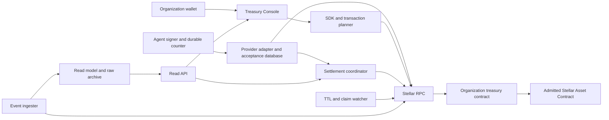
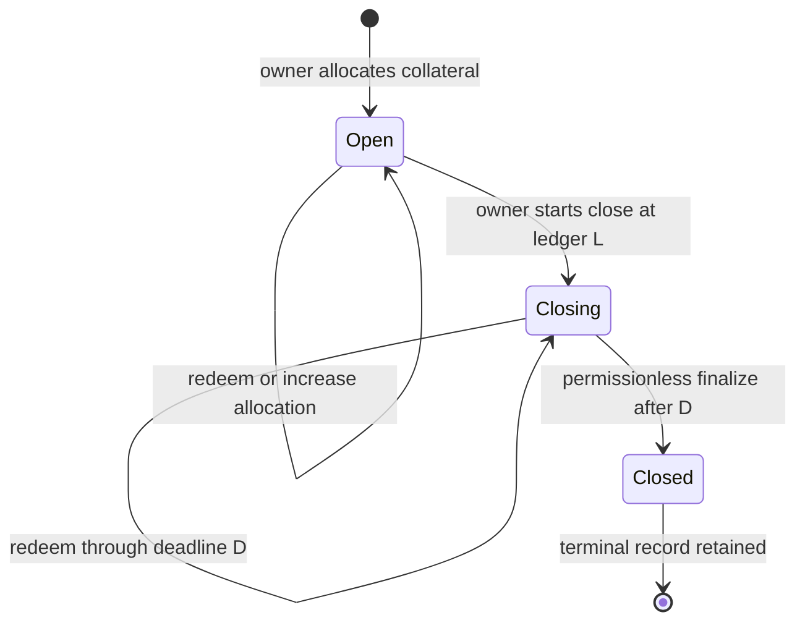
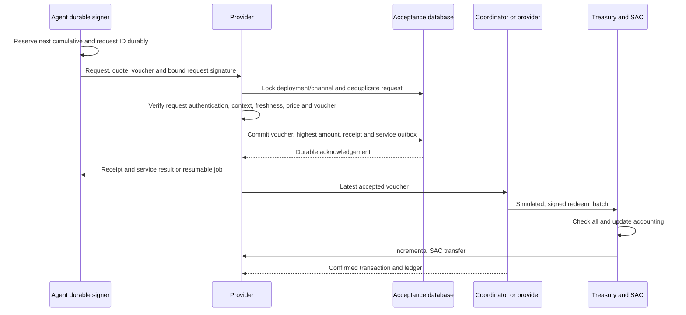

# AgentBatch architecture

This is the primary architecture for the completed product described in the
[vision](vision.md). **Production sections specify a proposed implementation;
they do not describe a deployed product.** The repository currently contains a
Testnet PoC. No production release, Mainnet deployment, independent security
audit, production service, or availability commitment is established here.

The design provides an organization-funded treasury, collateralized virtual
channels, delegated cumulative vouchers, and bounded settlement to independent
providers. It reserves collateral for provider claims and, in the production design,
allows eligible remainder to return to the treasury after a monitored claim
window. Claims not executed by the deadline can expire. Supporting references own the [voucher wire format](voucher-format.md),
[PoC accounting](accounting-invariants.md), [SDK contract](sdk.md),
[operations](production-operations.md), [maintenance and releases](maintenance.md),
and [decision records](decisions.md).

## 1. Scope and implementation baseline

### Product and economics

An organization funds service consumption by its agents. Treasury administrators
allocate collateral; agents authorize payments with separate Ed25519 keys;
providers verify payment increments before delivering services; a provider or
coordinator periodically submits vouchers for settlement. A virtual channel is
a contract record, not a separate deployment or a Stellar transaction channel
account. A treasury is scoped to one organization and one payment asset.

Payments are prepaid and fully collateralized. There is no credit creation,
yield, exchange rate, protocol token, percentage fee, or built-in coordinator
reward in the implemented contract. Providers earn service prices agreed off-chain.
The submitter pays network fees in XLM. Production coordinator and storage costs
must be funded separately by an operator service agreement; no deduction from
provider claims is authorized by this design. Batching still makes one asset
transfer and one signature verification per voucher; it is not payment netting.

The full product targets Stellar USDC. The actual PoC uses synthetic AUSD.
A production asset admission record must identify the exact issuer and SAC,
rather than accepting a ticker as identity. Unallocated liquidity can support
new channels; funds backing possible outstanding claims cannot be reused.

Requirements: bounded delegated exposure, exact accounting, independent provider
reservations, durable off-chain acceptance, protected closure, multiple isolated
organizations, wallet-based administration, an SDK, a Treasury Console, settlement
coordination, reconciliation, and explicit payment adapters. Exclusions from the
first production release: unsecured credit, refunds for service disputes enforced
on-chain, automatic service-delivery verification, arbitrary tokens, pooled
custody across organizations, cross-treasury atomic settlement, in-place code
upgrades, clearing/netting, and keeper incentives. A payment signature proves
payment authority, not that a service was delivered or that its output is correct.

### Evidence boundary

| Capability | Repository state | Completed-product requirement |
|---|---|---|
| Treasury and asset binding | Implemented: one owner/token per contract | Separate immutable deployment per organization/asset; shared reviewed WASM |
| Channels | Implemented: persistent records with fixed provider/key/allocation | Lifecycle, safe top-ups, stable agent identity, budget associations |
| Liability limits | Implemented per channel | Atomic aggregate agent/provider budget accounting within each treasury |
| Vouchers | Implemented `AGENTBATCH_POC_V1` | Preserve v1 decoding; separately version any new production domain |
| Settlement | Implemented atomic batches of 1–4 distinct channels | Same semantics; qualify resources, isolate bad candidates before submission |
| Closure, rotation, collateral release | Absent | Claim window and replacement channels; never erase outstanding rights early |
| Provider library | Implemented sequential verifier and memory/file stores | Transactional request deduplication and durable acceptance journal |
| SDK | Private Node voucher package; handwritten client in Testnet tools | Generated bindings, browser-safe core, wallet and transport interfaces |
| Console, indexer, hosted API, keeper | Absent | Production components specified below |
| Deployment evidence | Committed dated Testnet manifest and raw transaction XDR | Reviewed immutable production release manifest and durable artifacts |
| Integrations | Offline example and simulated providers | Tested, versioned adapters; no implicit MPP/x402 interoperability |

Current sources are [`lib.rs`](../contracts/agentbatch-poc/src/lib.rs),
[`types.rs`](../contracts/agentbatch-poc/src/types.rs),
[`storage.rs`](../contracts/agentbatch-poc/src/storage.rs), and
[`packages/voucher`](../packages/voucher/src/index.ts). The committed
[Testnet manifest](../deployments/testnet/manifest.json) records the 24 October
2026 deployment, SDK 27.0.6, JS SDK 17.2.1, CLI 26.0.0, Rust 1.94.1, and observed
protocol 29/RPC 30. Those are historical observations, not a current network
compatibility promise. `Cargo.lock`, `pnpm-lock.yaml`, `rust-toolchain.toml`, and
CI define the reproducible baseline. The changelog's historical 0.2.0 heading
does not change the workspace/package version of 0.1.0 or make private packages
published. Recorded benchmarks apply only to their dated workloads.

## 2. Components, deployment, and trust



Each organization/asset has one contract, isolating custody and treasury writes.
Identical contract code is uploaded once per network/version and reused.
A deployment catalog maps verified releases to contract IDs; it has no authority
over balances. There is no privileged global factory or router in the base
design. A later factory must preserve owner-authorized construction and cannot
silently select mutable code. Batches target a single treasury. Organizations
requiring a shared cap across several treasuries need an additional on-chain
policy design; the local budget guarantee does not span them.

Deploy the static console behind HTTPS/CDN; serve authenticated read and job
APIs separately. Run the coordinator, event ingester, and maintenance scheduler
as separate workers against a transactional relational database, with encrypted
object storage for raw XDR and release artifacts. PostgreSQL is the proposed
reference database for row locks, exact numerics, and migrations, not an existing
dependency. Start with one active lease-holder per treasury settlement queue;
scale across treasuries. Shared treasury writes remain a contention point even
if sources use different Stellar accounts. Hosting provider, region, replicas,
and failover topology require operator selection and load qualification.

| Boundary | Authority and residual trust |
|---|---|
| Organization wallet | Authorizes treasury administration. A compromised owner can spend available funds and allocate new exposure; cannot redirect existing providers' claims. Use account thresholds or reviewed contract-account policies. |
| Delegated signing service | Holds agent keys and serialized counters, never owner keys. Theft risks remaining channel allocations, including the claim period. |
| Provider | Controls request price, acceptance journal, and service delivery. Its state is necessary to recover unredeemed claims. |
| Coordinator | Sees submitted vouchers and can pay fees. Cannot choose recipients or withdraw collateral. Providers retain independent submission. |
| RPC | Supplies simulations, ledger state and results; HTTPS is transport authentication, not a proof of ledger state. Use controlled RPC and independent corroboration for critical actions. |
| Indexer/API | Supplies discoverability and history. Must report ledger freshness and gaps; never grants financial authority. |
| Asset issuer/admin | May restrict transfers or claw back eligible balances. Contract accounting cannot override issuer powers. |
| Console and dependency delivery | Can mislead wallet signing if compromised. The wallet must display and validate network, target, arguments and authorization tree. |

## 3. Implemented contract specification

### Interfaces and authorization

| Entry point | Types / authorization | Behavior |
|---|---|---|
| `__constructor(owner, token)` | `Address, Address`; owner `require_auth()` | Runs once; calls token `decimals() == 7`; stores config and zero treasury with next ID 1. Does not prove token is a SAC. |
| `deposit(amount)` | `i128`; owner | Positive amount; credits totals then transfers owner→treasury; requires exact before/after treasury balance delta or rolls back. |
| `open_channel(provider, signer_key, allocation)` | `Address, BytesN<32>, i128`; owner | Positive allocation ≤ available; rejects provider equal to owner, treasury, token and all-zero signer; reserves funds; returns `u64` ID. |
| `redeem_batch(vouchers)` | `Vec<Voucher> -> i128`; no caller `require_auth()` | 1–4 distinct channels; verifies signatures, requires redeemed < amount ≤ allocation; pays differences to stored providers; returns total payout. |
| `withdraw_available(amount)` | `i128`; owner | Positive amount ≤ available; transfers treasury→owner. |
| `get_treasury()` | `TreasuryView` | Accounting, actual balance and signed surplus/deficit. Calls token balance and can fail if a dependency cannot be loaded. |
| `get_channel(channel_id)` | `u64 -> ChannelView` | Stored configuration, allocation, redeemed, remaining, creation ledger. |
| `voucher_message(channel_id, amount)` | `u64, i128 -> Bytes` | Encoding parity helper; can encode zero/negative/out-of-allocation amounts, without making them redeemable. |

Owner authorization covers exact arguments. Deposit's authorization tree includes
nested `token.transfer(owner, treasury, amount)`. Treasury-originating direct SAC
calls rely on contract-invoker authorization, not a provider signature or a
coordinator's ownership of the treasury. Permissionless redemption still needs
a valid Stellar transaction source/signature and fees. Agent voucher signatures
are a separate protocol from Soroban authorization entries. The
[authorization guide](https://developers.stellar.org/docs/build/guides/auth/contract-authorization)
explains host-enforced invocation trees; production wallets must also support
the credential format of the admitted network/SDK combination.

### State, arithmetic, and failures

Config `{owner, token}` and Treasury `{total_deposited, total_paid,
total_withdrawn, available, total_reserved, next_channel_id}` are instance data.
`DataKey::Channel(u64)` stores each persistent Channel `{id, owner, provider,
signer, allocation, redeemed, created_ledger}`. IDs are never reused; increment
overflow rejects creation. There is no stored lifecycle status; a fully paid
channel remains a record. There is no close, owner setter, signer setter,
allocation setter, pause, upgrade, or surplus recovery function.

All financial values are signed i128 base units with seven decimals:
`1 AUSD = 10_000_000`. Mutation arithmetic uses checked operations. No percentage,
conversion, division, or rounding occurs on-chain. Views use saturating or bounded
arithmetic; this is not a general guarantee that a view cannot trap.
The negative surplus of a clawback-induced deficit is preserved by signed
`saturating_sub`; it is not clamped to zero. Seven decimals do not prove that an
arbitrary token behaves honestly.

The batch checks size and duplicate IDs first (bounded quadratic comparison,
at most six pairs), then reads each channel, verifies its signature, checks
amount bounds, writes counters, and collects payouts. Transfers occur after
all accounting writes. Any returned contract error, signature trap, resource
failure, or token transfer failure aborts the invocation. Accounting writes,
payouts, and successful contract events roll back; an included failed transaction
can still consume fees and its source sequence. Zero/negative vouchers with
valid signatures fail `StaleVoucher`, rather than `InvalidAmount`.

Contract errors: 101 InvalidAmount, 102 InsufficientAvailable, 103 InvalidProvider,
104 InvalidSigner, 105 ChannelNotFound, 106 EmptyBatch, 107 BatchTooLarge,
108 DuplicateChannel, 109 StaleVoucher, 110 ExceedsAllocation,
111 ArithmeticOverflow, 112 InvalidToken, 113 TransferMismatch. Invalid signatures
raise host cryptographic errors. Nested SAC failures retain their own error
namespace (tests exercise SAC 10 and 11). The current numeric separation from
SAC 1–15 is not a namespace guarantee for arbitrary external contracts or future
versions. Preserve failing invocation context when decoding errors.

### Events

[`events.rs`](../contracts/agentbatch-poc/src/events.rs) and exact-XDR
[event tests](../contracts/agentbatch-poc/src/test/events.rs) define the schema.
The SDK macro emits the event name as the first topic in snake case.

| Event name | Additional topics | Data fields |
|---|---|---|
| `deposited` | owner | amount, available |
| `channel_opened` | channel_id, provider | signer, allocation |
| `voucher_redeemed` | channel_id, provider | cumulative, payout |
| `batch_redeemed` | none | vouchers, total_payout |
| `withdrawn` | owner | amount, available |

Use contract ID plus code/spec version when decoding. The SAC emits its own
transfer events. Diagnostic events from simulation or failures are not successful
payment receipts. Production adds versioned budget, top-up, close-start, and
close-finalized events with affected IDs, amounts and deadline; these event types
are not present today. Constructor/deployment catalog records must supply owner,
asset and initial configuration; existing events alone do not describe every
constructor argument.

## 4. Production contract and lifecycle design

The following is a proposed ABI shape, requiring a new reviewed contract version
and generated bindings. It does not extend the deployed PoC in place. Reuse
existing deposit/redemption/withdrawal semantics and add bounded operations:

```text
set_budget(kind: Agent|Provider, subject, cap: i128) -> id       owner
open_channel_v2(provider, agent_id, signer, allocation,
                key_proof)                                    owner
increase_allocation(channel_id, additional: i128)              owner
start_close(channel_id) -> close_deadline: u32                 owner
finalize_close(channel_id) -> released: i128                   permissionless
get_budget(id), get_channel_v2(id), get_config()               public views
```

The immutable constructor binds organization owner, admitted asset, protocol
version, and claim-window length `W` in ledgers. Treasury contract identity is
the treasury identifier. Stable owner-defined agent IDs group keys for budgets;
a key change cannot create fresh budget capacity. Provider subjects are exact
payout addresses; any cross-address business identity grouping needs explicit
owner configuration and atomic accounting. The first production version has
exactly one persistent budget keyed by `(kind, subject)` for each agent ID and
provider address in a treasury. `set_budget` creates it once or changes its cap
in place; it never resets spent/reserved or creates a duplicate budget. Opening
resolves the two existing budget keys from `agent_id` and `provider` internally;
the caller cannot substitute unrelated budget IDs. Store those immutable
associations on the channel, and require their kinds/subjects to match on every
affected mutation. Missing budgets fail rather than default to unlimited. This
keeps updates bounded to one budget per dimension. Caps govern registered
identities, not a provable real-world person/process: deliberately enrolling
another agent identity is a new owner-authorized grant, not key rotation.
Key registration must verify a canonical safe public key and a domain-separated
proof over network, contract, agent identity and registration arguments; proof
of possession does not grant treasury rights.

### Protected closure and signer replacement



`D = checked_add(L, W)`. `W > 0` is immutable and published before providers
accept a channel. It must cover monitoring lag, outages, restoration, signing,
submission contention and safety margin. A release must publish a numerical
window backed by recovery exercises; no arbitrary production window is chosen
from the PoC's TTL constants. Claims are accepted while open or while closing
with `ledger.sequence <= D`; finalization requires `sequence > D`. Among
redemption/finalization of a closing channel, only redemption is eligible at D.
A repeated start-close returns the original D; no caller can shorten or extend D,
reopen a closing record, or reassign its remaining collateral. Eligibility uses
the ledger in which the invocation executes successfully, not signing time,
RPC receipt, queue acknowledgment or simulation ledger. Competing transactions
are resolved by execution order with the same guards; no read-model observation
authorizes release.

V1 cumulative vouchers contain no trustworthy issuance timestamp. The production
base design therefore honors **any otherwise valid signed cumulative claim
successfully executed at or before ledger D**, including one signed after
close starts. An RPC-accepted transaction that executes at D+1 is too late; a
provider must confirm the successful result with ledger ≤ D.
Providers stop serving once they observe closing and must monitor with a bounded
freshness limit. Revocation means disabling new service acceptance and starting
closure; it cannot instantly nullify signatures. A compromised key can exhaust
its remaining allocation through D. This risk is deliberately bounded by reserved
collateral. Unredeemed claims expire after D even if signed or submitted earlier; a
failed invocation at D does not preserve a claim for execution at D+1. An
offline provider/watchtower that misses the window may lose its claim.

Rotation uses a new channel with a new key and unique ID, keeping the old channel
and reservation claimable until finalized. New exposure needs available funds
and budget headroom; rotation cannot recycle the old reservation immediately.
Top-ups are positive increases while open, checked against available liquidity
and both budgets. Stale provider allocation caches then underestimate capacity
rather than overstate it. No allocation reduction is allowed before finalization.
There is no general pause that blocks outstanding redemption. Incident response
can halt new openings/top-ups in the services and close affected channels; any
future on-chain pause must separately preserve the claim path.

After D, finalize computes `q = allocation - redeemed - released`, moves q from
reserved to available, sets `released += q`, and marks Closed. Repeated finalize
returns zero without another release; all later vouchers fail Closed. Retain a
terminal tombstone/counter and never reuse IDs, even after archival. Fully paid
channels follow the same terminal process with q = 0. Reassignment is a new
allocation from available, not a rewrite of an old channel. Unsolicited surplus
remains uncredited; a production sweep is excluded until separately specified.

### Financial conservation and aggregate budgets

Let Dp be deposits, P payouts, X withdrawals, A available, R reserved, B actual
asset balance. For each channel c, let a be total allocation, r redeemed, and l
released. All are nonnegative exact base units.

```text
Dp - P - X = A + R
remaining[c] = a[c] - r[c] - l[c] >= 0
R = sum(remaining[c])
B >= A + R              conditional on admitted asset behavior and issuer action
surplus = B - (A + R)   uncredited; a deficit is an incident
```

For each agent/provider budget b, persist `spent[b]` and
`reserved[b] = sum(remaining[c] associated with b)`.
Enforce `spent[b] + reserved[b] <= cap[b]`. Opening or topping up reserves in
both dimensions; paying delta transfers delta from reserved to spent in both;
closure releases only remaining reservation. Settlement **does not free budget
capacity for more spending**. Lowering cap below spent+reserved fails. Budget
counters are cumulative for the budget's lifetime; there is no calendar reset.
The first production version has no budget epochs, deletion/recreation or
period rollover. Time-window resets and migration between budget identities need
a separate protocol; the administration API cannot relabel or zero lifetime
counters. Explicitly changing a cap is a new owner-authorized spending grant. Overall liquidity
cannot be inferred by adding agent and provider budgets: both index the same
channel obligations, so that sum would double-count exposure.

| Transition | Change to A | Change to R | Change to P | Budget effect per dimension |
|---|---:|---:|---:|---|
| Deposit x | +x | 0 | 0 | none |
| Open/top-up x | −x | +x | 0 | reserved +x; enforce cap |
| Redeem delta | 0 | −delta | +delta | reserved −delta; spent +delta |
| Finalize remainder q | +q | −q | 0 | reserved −q |
| Withdraw x | −x | 0 | 0 | none; X +x |

For the documented 100-token example, channels 40/35/15 reserve 90 and leave
10 available. Payouts 12/8/5 leave B=75, R=65, A=10. Cumulative 17 on the first
channel pays 5 more: B=70, R=60. If that channel then closes without further
claims, its 23 remaining units return to available after D: A=33, R=37, B=70.
The agent's spent counter stays 17. These closure figures are design arithmetic,
not results from an implemented close function.

Every mutating operation touches bounded channel/budget entries and uses checked
arithmetic; no on-chain iteration across all channels. Treasury aggregates stay
small. New channel/budget maps use persistent storage; no liabilities,
monotonic counters or terminal states use temporary storage. The current cap of
four vouchers is retained until worst-case qualification proves an alternative.
Resource qualification includes maximum argument/event bytes, authorizers,
archived dependencies, budget writes, provider account types, TTL rent, memory,
instructions, footprint, transaction size and contention. Admission limits and
fee/rent ceilings are release configuration, not universal Stellar constants.

## 5. Voucher and service protocol

The implemented payload is canonical XDR `ScVal::Map` with sorted symbols
`amount, channel_id, contract, domain, network, owner, provider, signer` and domain
`AGENTBATCH_POC_V1`. Only channel ID, cumulative amount and signature are submitted.
The contract derives all other fields from storage/environment. The agent
signs the XDR bytes with pure Ed25519 and the contract verifies them; the
voucher is not a Stellar transaction or Soroban auth-entry signature. See the
[wire reference and vectors](voucher-format.md).

Off-chain verification is intentionally at least as strict as the pinned host:
`verifyStrict` additionally rejects noncanonical point encodings; safe-key
admission further narrows allowed channels. It is incorrect to promise acceptance
of every host-valid signature. Both implementations must reproduce the shared
positive and host-rejected edge vectors on every crypto/host upgrade.

The proposed production domain is `AGENTBATCH_V1`, using the same eight field
names, types and sorted map layout with the new domain symbol. It is not
implemented or accepted by the PoC. Contract identity identifies the treasury;
the immutable channel binds its stable agent and budget associations without
adding caller-controlled policy fields. Freeze this specification with new
cross-language vectors before implementation release. Distinct contract IDs
already prevent PoC vouchers from redeeming on a replacement contract. Transport
request IDs, prices and service metadata are not covered by either voucher
payload. Service access therefore requires a separate authenticated request,
not possession of a voucher or knowledge of its channel ID. This separate
request signature does not alter the on-chain voucher ABI.

### Authenticated service requests

The proposed reference provider protocol requires client-authenticated TLS with
an admitted client certificate, plus a separately domain-separated Ed25519 request
signature verified against the channel's registered signer before acceptance.
The signed request binds the client certificate's SHA-256 fingerprint; the
presented TLS client certificate must match. Acceptance, retries, receipt lookup
and result delivery enforce this same client identity. A stolen voucher may
still be redeemed
permissionlessly to the stored provider, but cannot grant a new caller access to
service or a confidential result. A replay of a complete authenticated request
returns only its existing receipt to the authenticated channel principal; it
cannot execute a changed request or create another paid job.

Freeze the request message as XDR `ScVal::Map` with sorted symbol keys:

| Key | Type and binding |
|---|---|
| `body_hash` | BytesN<32>, SHA-256 of the exact transmitted request body bytes |
| `channel_id` | u64, channel used for payment |
| `client_identity_hash` | BytesN<32>, SHA-256 of the admitted DER-encoded leaf TLS client certificate |
| `contract` | Address, admitted treasury |
| `domain` | Symbol, proposed `AGENTBATCH_REQUEST_V1` |
| `expires_ledger` | u32, inclusive last ledger for new acceptance; provider enforces against a fresh observation |
| `network` | BytesN<32>, network ID |
| `provider` | Address, stored payout provider |
| `quote_hash` | BytesN<32>, hash of the provider's immutable canonical quote |
| `request_id` | BytesN<32>, fresh random idempotency identifier |
| `voucher_hash` | BytesN<32>, SHA-256 of canonical XDR of the submitted three-field Voucher map |

The provider stores the canonical quote before issuing its hash. Quote terms bind
provider origin, HTTP method, exact path/query, asset, treasury/channel, service,
price in base units, expiry and delivery/retry terms; verify the served request
against all terms and reject noncanonical or ambiguous routing. Define canonical
quote encoding and shared request/quote vectors before adapter release. TLS
authenticates the server and admitted client; the request signature binds
that client identity to the channel. A replayed signed request on a different
TLS client certificate identity fails, even when its voucher/signature are valid.
Receipt/result retrieval requires the stored client identity and its authenticated
TLS session, rather than treating request IDs or captured signatures as bearer
credentials. Certificate rotation needs authenticated identity migration recorded
by the provider; it cannot be requested by presenting only an old request. A TLS
terminating proxy must convey verified client identity over an authenticated
backend connection; an untrusted client-supplied certificate header is
insufficient. Expired requests cannot create new acceptance; an already accepted
request remains recoverable under its recorded terms and authenticated retrieval
flow. These are proposed adapter requirements, not exports of the current library.



The proposed provider first authenticates the complete request, then locks
`(deployment, channel)` in a database transaction. It rejects
amount ≤ max(highest accepted, observed redeemed), amount > allocation, unsafe
key, bad signature, insufficient increment, stale network/lifecycle observation,
or a conflicting reuse of request ID. Commit the signed voucher and a receipt
before delivering a paid result. A unique
`(network, generation, treasury, provider, request_id)` stores client identity,
request hash, quote, voucher hash, cumulative amount and service status. A repeat with
identical parameters returns the existing receipt/result and consumes no new
increment; a conflicting repeat is rejected. A fresh quote must cover the whole
new cumulative increment under the service policy; no hidden overpayment buys
future requests automatically. Serializing agent requests per channel is the
initial ordering policy: concurrent voucher creation cannot reserve the same
counter, and sending a higher voucher before its earlier request is acknowledged
can make that earlier voucher stale. On timeout, query the original request
instead of advancing the counter. An outbox drives resumable service
execution. Payment acceptance and arbitrary external service execution cannot
be made one atomic transaction: delivery failures require retry or an explicit
provider refund policy outside the base contract.

Agents persist the highest **ever signed** cumulative amount before exposing a
voucher, with a single writer or database CAS per channel. Unknown provider
outcomes are resolved by request ID and receipt; do not blindly issue another
increment. Restarting from redeemed alone loses outstanding authorization
history. The current `ChannelSpender` is memory-only; demo `agentFor` starts from
redeemed because the controlled scenario first settles the preceding claims.
The file store fsync/rename model is sequential and is not a production database;
a write failure requires stopping and recovering durable state before serving.

## 6. Asset identity and custody

An admitted asset record binds `(network passphrase/hash, asset code, issuer,
SAC contract ID, decimals, observed issuer/admin controls, observation ledger)`.
Derive the SAC address with the pinned official SDK's `Asset.contractId` and
compare it to the release manifest. Seven-decimal validation alone admits a
malicious look-alike contract; production clients/deployment review must enforce
the exact SAC allowlist. No default Mainnet USDC issuer is invented here.

SAC G-account holders use classic trustlines; C-address holders use contract-data
balances. The same asset moves between them without a bridge or wrapped asset.
Non-issuer G-account providers need an existing authorized trustline with enough
receiving capacity; classic balances/trustlines use signed i64 even though the
SAC interface and contract balances use i128. Account transfers must satisfy the
narrower amount and receiving-headroom limits, including liabilities; fitting
i128 is insufficient. The issued asset's issuer is a special case without a
self-trustline: transfer to it retires units instead of crediting an ordinary
holder balance. The PoC does not exclude that payout address. Production
admission rejects issuer-as-provider to retain ordinary service-payment semantics.
C-address recipients do not establish classic trustlines; their SAC balance's
authorization/clawback state and storage lifecycle matter. See the official
[SAC overview](https://developers.stellar.org/docs/tokens/stellar-asset-contract).

An issued-asset SAC administrator can perform supported authorization, mint,
clawback, and admin-change operations, subject to the asset's controls. Contract
balance clawback eligibility is established when that balance is created;
account trustlines have their own flags. Authorization required and revocable
settings affect whether a balance can transact. Review actual issuer flags,
SAC admin and per-holder state; “no flags” in a historical demo is not a permanent
issuer-policy promise. The native SAC has no issued-asset administrator.
[CAP-46-6](https://github.com/stellar/stellar-protocol/blob/master/core/cap-0046-06.md)
defines these distinctions. Freeze can preserve arithmetic while blocking payment;
clawback can make B < A+R. Never silently socialize that shortfall or mark claims
paid. Operator remediation needs issuer coordination and an explicit funding plan.

Custody is in the treasury's SAC balance, governed by the reviewed code. Deposit
checks the incoming balance delta; current withdrawal/redemption assume exact
outgoing transfers. Supporting arbitrary SEP-41 tokens would require additional
behavioral review, outgoing checks and compatibility testing. The
[SEP-41 interface](https://github.com/stellar/stellar-protocol/blob/master/ecosystem/sep-0041.md)
specifies methods; it does not certify a token's implementation or asset value.

## 7. Networks, releases, and transaction execution

### Identity and provenance

The committed identities remain in the [historical manifest](../deployments/testnet/manifest.json):
AUSD SAC `CCIU2DJZIBZBUVXTHE2EUBQMJ3AZLOZNKQEQJK5HPIO4KIT4SMISAX2R`, demo treasury
`CCNFYVZNOP7TK4BK4PMF36FU7UXC4SN4G6LQWTQ3CBLAR4EBDT4YKMGJ`, and WASM SHA-256
`ab37537a6f65418bc968c4133ca9e9700d3980fd5a5915967e5914ce53068a04`.
These records do not establish that those entries are live today.

A production release manifest must add source revision/tree status, build-image
and optimizer digest, lockfile checksums, artifact/spec hashes and sizes,
constructor arguments, deployment transaction/envelope/result/ledger, deployment
salt or reproducible preimage, owner, asset admission record, network passphrase,
minimum compatible protocol/SDK/wallet versions, schema/domain/event versions,
claim window, service endpoints, reset generation, verification identity and
artifact locations. Keep signed approvals separate from secret signing material.
Verify fetched on-chain code bytes and constructor state before admitting funds.
Current manifests omit several of these fields; do not use them as production
release provenance without completing them.

Testnet may reset while reusing its network passphrase and deterministic asset
IDs. Use fresh treasury salts and signing keys, a new deployment generation and
new store scope, and discard pending jobs/cursors from the old generation.
Detect a reset through configured operator notice plus ledger identity/regression
checks, not merely a changed passphrase. An off-chain generation label alone
cannot prevent a v1 voucher replay if identical contract/key/channel state is
recreated. Never recreate that signing context. Archive old evidence without
rewriting it. Official [network documentation](https://developers.stellar.org/docs/networks)
distinguishes Testnet resets and Friendbot from funded Mainnet operations.

### Transaction source, payer, and authorizers

| Role | Meaning | Example |
|---|---|---|
| Transaction source | G-account supplies sequence and envelope authorization | Owner directly, or isolated coordinator submission account |
| Fee payer | Normally source; outer account for a fee-bump envelope | Sponsored operational fee account |
| Contract authorizer | Address whose `require_auth` tree must be satisfied | Treasury owner for deposit/open/withdraw/close |
| Voucher signer | Raw delegated Ed25519 key in a channel | Authorizes a cumulative payout, not transaction fees |

Fee sponsorship cannot satisfy owner contract authorization. C-address owners
need their contract-account authentication path; they are not transaction source
accounts. For owner-as-source calls, source-account credentials can rely on
envelope authentication. For relayed administration, obtain signed address
credentials for the exact owner invocation and nested calls. Preserve nonce,
network, expiration ledger and credential type with the signed entry. Never
replace address authorization with the coordinator's signature. The official
[signing guide](https://developers.stellar.org/docs/build/guides/transactions/signing-soroban-invocations)
describes these flows; [fee-bump envelopes](https://developers.stellar.org/docs/build/guides/transactions/fee-bump-transactions)
wrap a signed inner transaction and need their own payer signature.

Protocol-sensitive authorization must use the pinned SDK's supported credential
helpers and wallet capabilities. The official
[protocol 27 migration guide](https://stellar.github.io/js-stellar-sdk/migration/protocol-27-soroban-auth/)
describes address-bound credentials and v17's changed XDR API. Do not copy legacy
credential accessors or hand-built authorization hashes into a production client.
These host credentials are distinct from AgentBatch's delegated voucher format.

Separately signed address credentials are portable across transaction envelopes
while their signed invocation, network, nonce and expiration remain valid. They
are not generally bound to the submitting account, transaction hash, source
sequence, fee or envelope time bounds. A relayer can re-envelope them; changing
source or waiting for the original transaction to expire does not cancel them.
Log every issued credential's authorizer, nonce, credential type, expiration and
invocation digest under its intent. For non-idempotent administration, do not
issue fresh authorization for the same unresolved economic intent until all old
credentials are provably consumed by reconciled successful effects or the trusted
ledger is past their expiration and outcome coverage is complete. In the pinned
host, expiration ledger E is still valid at E and is expired only at E+1; a failed
call can roll nonce consumption back. An absent nonce entry alone does not prove
it was never used. The installed SDK 17.2.1 documentation describes the boundary
as exclusive; use the pinned host's conservative E+1 expiry rule and require
target-network boundary tests before release. Reuse an existing valid credential,
where safe and reconciled,
instead of manufacturing another grant. Source-account credentials rely on the
envelope and have a different replay boundary. The
[authorization reference](https://developers.stellar.org/docs/learn/fundamentals/contract-development/authorization)
describes nonce/expiration enforcement; the SDK must not promise economic
exactly-once behavior from an off-chain idempotency key alone.

### Production transaction state machine

`draft -> simulating -> awaiting_authorization -> signed -> submitted ->
confirmed_success | confirmed_failure | unknown`; expired/unsubmitted plans
return to preparation only after their outcome has been reconciled.

1. Resolve the admitted deployment and fresh network/ledger state. Validate
   target method, exact integer bounds, identities, balance, lifecycle and budget
   inputs. Acquire a source sequence lease; persist intent and idempotency key.
2. Build one Soroban operation with finite time bounds and appropriate ledger
   constraints. Simulate against the selected endpoint, record ledger/protocol,
   inspect return/errors, required authorizations, footprint and restoration.
   Simulation is a state-dependent estimate, not a reservation or success proof.
3. Assemble resources/fees with the pinned SDK, an approved instruction margin,
   and operator limits. Reject estimates beyond resource, inclusion, rent or total
   cost ceilings. If restoration cannot fit, follow the recovery flow below.
4. Present and authorize the exact invocation tree. For deposits this includes
   the nested owner→treasury token transfer. Validate signed auth entries and
   simulate in enforcing mode where supported after attaching them, accounting
   for custom-account verification resources. If calls/arguments/credentials or
   resources change, rebuild and collect affected signatures again.
5. Sign the final envelope. Decode the wallet return and compare network hash,
   operation, source, sequence, bounds, fees, auth tree and target to the approved
   plan. Persist signed XDR, hash, source sequence, expiration, voucher identities
   and job ID **before** submission. Persist separately issued owner credentials
   even if the wallet disconnects before signing an envelope. Fee-bump wrappers
   track inner and outer hashes. A transaction envelope carries no network
   passphrase field: calculate its hash using the admitted passphrase and verify
   signatures in that context rather than attempting to read a network from XDR.
6. Submit and handle [RPC submission states](https://developers.stellar.org/docs/data/apis/rpc/api-reference/methods/sendTransaction).
   PENDING/DUPLICATE lead to polling; TRY_AGAIN_LATER permits bounded backoff on
   the same envelope; transport timeout means unknown. ERROR needs decoded
   rejection and reconciliation before rebuilding. Retry policy must prevent
   creating a second economic action while an earlier plan is unresolved.
7. Poll `getTransaction` for the exact hash, recording result/meta and ledger.
   SUCCESS confirms execution; FAILED confirms included failure and no contract
   payout. NOT_FOUND does not prove rejection or non-inclusion. Before retrying
   with a new sequence, establish expiration, source sequence consumption and
   authoritative outcome or sufficient contract postconditions; use an archive if
   retention has elapsed. Reconcile all portable authorizations as described above
   before signing a fresh grant. Deposit/open/withdraw are not safe to repeat
   based on timeout, envelope expiry, or a consumed source sequence alone.
8. Refresh channel/accounting state. For a stale race, inspect redeemed and
   reconcile the claim; a failed batch can contain both already-paid and still
   unpaid channels. Rebuild only unpaid candidates. Retain intent and all failed
   attempts; never label the entire batch paid from a submission acknowledgment.

The current `Chain` uses a 120-second timeout, source-as-payer signing, simulation,
assembly and polling. It throws for DUPLICATE/TRY_AGAIN_LATER, stops on unknown
outcome and rejects restoration preambles; it has no durable production intent,
wallet auth collection, multi-source lease, or general retry service.

Under SCP's safety assumptions, a result in a closed ledger is final; waiting for
additional probabilistic confirmations is not the base model. An RPC response
still needs a trusted or corroborated ledger source; endpoint lag can delay
observation without reversing execution. Network stalls can stop progress. See
[SCP](https://developers.stellar.org/docs/learn/fundamentals/stellar-consensus-protocol)
and the [transaction lifecycle](https://developers.stellar.org/docs/learn/fundamentals/transactions/transaction-lifecycle).

## 8. Storage lifetime and restoration

Current TTL constants are 120,960 ledgers (threshold) and 518,400 ledgers (target),
approximately 7/30 days only at five-second cadence. Successful mutations extend
the instance at threshold; opening ensures the channel target; redemption extends
touched channel entries at threshold. Views do not persist TTL changes. Shared
WASM is deliberately not extended by contract mutations. No keeper exists today.

Production must retain the complete dependency set: treasury instance and code,
channel records, budget records, terminal/replay state, SAC instance, relevant
SAC contract balances, and any contract-account authorization dependencies.
The SAC is built into the host, so it has no uploaded WASM code entry of its own;
retain its instance/balance entries and qualify the host protocol version.
Classic accounts/trustlines are subject to their own reserve rules rather than
Soroban TTL. Extension of one entry does not retain another. Terminal records
remain restorable; their archival never creates a fresh channel or resets spent.

Protocol 23+ supports automatic restoration for archived entries included in the
prepared invocation's restoration information. It is not unconditional access:
missing restore information/resources can make application fail. Persistent and
instance state is archived; temporary state is irrecoverably removed. Follow
[CAP-66](https://github.com/stellar/stellar-protocol/blob/master/core/cap-0066.md)
and [state archival](https://developers.stellar.org/docs/learn/fundamentals/contract-development/storage/state-archival).

The scheduler inventories keys/TTL, deduplicates code shared across treasuries,
and extends live entries with `ExtendFootprintTTLOp` in bounded chunks. Archived
entries need prepared auto-restoration or `RestoreFootprintOp`, not an extension
of unavailable state. If simulation returns a restore preamble, budget and submit
a separate restoration transaction, confirm it, reload sequence and re-simulate
the original action; no stale signature/footprint reuse. If auto-restore exceeds
limits, restore dependencies in bounded transactions first. Simulation-based
views can show restored state without persisting the restoration; a successful
read does not prove the entry has become live on-chain.

Rent is paid in XLM by the submitting account; forecast it separately from payment
asset collateral. Daily maintenance cost is the sum of simulated entry-extension
costs, shared-code cost counted once, restoration contingency and inclusion fees.
Choose scan interval and funding reserve so the minimum live-until margin exceeds
scan lag + operator recovery + claim submission margin. Validate network max TTL
and current fees on every release; constants that exceed an admitted network's
limits fail acceptance. See [operations](production-operations.md) for ownership,
funding and recovery, and [network metering](https://developers.stellar.org/docs/learn/fundamentals/fees-resource-limits-metering)
for distinct resource and inclusion costs.

## 9. Treasury Console and SDK

The Console is a proposed browser application, absent from this repository.
It uses the SDK's immutable deployment configuration, query cache keyed by
network/generation/contract, exact integer formatters, and a separate transaction
state machine. Keep wallet connection state separate from chain truth and
pending intents; URL/navigation changes must not move a pending action between
networks. Read-model totals show their ledger/freshness; signing preflight reads
a trusted chain source. Show discrepancies rather than replacing stale data
with a misleading zero balance.

Journeys: connect and verify network; select/create a treasury; inspect asset and
issuer controls; fund and confirm; register agent budgets/keys and provider;
allocate with worst-case exposure preview; inspect provider claims and payments;
top up; start closure with deadline and operational obligations; rotate via a
replacement channel; finalize eligible closure; withdraw available funds; export
history and reconcile unknown attempts. Provider views show accepted versus
redeemed claims and close deadlines. An administrator cannot discover private
unsubmitted vouchers solely from chain data.

Validate G/C address roles, token identity, positive decimal input with ≤7 places,
i128/u64 bounds and no exponent/comma ambiguity. Reject excess precision, rather
than round. Explain AUSD/USDC and XLM fee estimates separately. Warn on outdated
code, issuer restriction, insufficient liquidity/headroom, stale state, pending
source sequence, or close-window danger. A wallet disconnect/rejection before
submission is recoverable without marking a payment failed on-chain. After
submission retain hash/status through reload and poll until reconciled; never
request a fresh payment because a modal closed. Distinguish refusal before any
signature from disconnect after a portable owner credential was issued: the
latter may still execute under another envelope and must remain visible as
outstanding authority until reconciled or expired. Closing a modal is not
credential revocation.

Support keyboard-only use, visible focus, associated form errors, readable
amount/asset labels, screen-reader status announcements and reduced motion.
Do not rely on color for pending/failure/expiry. Display ledger deadlines with
approximate local time and the ledger condition that actually governs them.
Browser secrets are wallet-managed; delegated agent seeds never enter the
console, analytics, URLs or localStorage. Content security policy, reviewed
bundles, pinned release configuration and protected deployment access are
required hosting controls, not enabled by this document.

The [SDK reference](sdk.md) defines current exports, Node-only limitations,
proposed packages, generated ABI versioning, wallet adapter boundaries, error
normalization and executable offline usage. The current voucher package's
filesystem and Node crypto imports make its root entry unsuitable for an
unmodified browser build.

## 10. Indexer, APIs, and background services

An indexer is unnecessary for PoC settlement correctness: direct views plus
provider stores suffice. The completed Console needs persistent channel discovery,
history, deadline scheduling, export and reconciliation beyond RPC history;
therefore the production reference deployment **requires an indexer and durable
raw archive**. It remains outside custody and signature validation. Providers can
redeem directly when it is down.

Ingest successful contract events via RPC `getEvents`, capture transaction
results/meta for payment and accounting checks, and bootstrap constructor/config
from verified deployment manifests. A durable ledger/transaction metadata feed
or operator archive provides full replay and captures external SAC balance
changes such as clawbacks or unsolicited transfers. Treasury events alone cannot
account for those external changes. Current contract state repairs projections,
but cannot reconstruct every missing historical action.

| Proposed table | Key and essential fields |
|---|---|
| `deployments` | `(network_id, generation, contract_id)`; asset, owner, code/spec/domain, start ledger, trust record |
| `raw_transactions` | deployment scope + hash; ledger, transaction order, status, envelope/result/meta object checksum/location |
| `raw_events` | network/generation + RPC event ID; tx hash, contract, event ordinal, raw topics/data, successful-call flag, decoder version |
| `channels` | deployment + channel ID as exact numeric; provider, agent/budgets, key, allocation/redeemed/released, status/deadline, observed ledger |
| `treasury_snapshots` | deployment + ledger/hash; exact totals, observed balance, deficit and reconciliation status |
| `budgets` | unique `(deployment, kind, subject)`; immutable identity, cap, spent, reserved and observed ledger |
| `checkpoints` | feed/deployment/generation; opaque cursor, fully ingested ledger, ledger hash, schema version |
| `transaction_intents`, `jobs` | scoped client idempotency key, immutable request digest, envelope hashes, source/sequence lease, attempts, deadlines, outcome |
| `authorization_attempts` | intent, authorizer, nonce, credential type, invocation digest, expiry ledger, issued credential, observed consumption/effect evidence |

Store amounts as constrained decimal integers capable of i128 (e.g. NUMERIC(39,0)
with i128 bounds), u64 IDs as constrained NUMERIC(20,0), and binary XDR unmodified.
Serialize money and IDs as decimal strings in JSON. Provider acceptance journals
and agent signer counters belong in their operators' private databases, not the
public index; submitting a claim to the coordinator requires authenticated access
and encrypted storage because a voucher is a redeemable payment authorization.

Poll bounded inclusive-start/exclusive-end ledger ranges; follow RPC opaque
pagination cursors without parsing them. Deduplicate on RPC event ID in its
network/generation, and retain `(tx hash, contract, event ordinal)` for canonical
archive cross-reference. Validate identity by decoding successful metadata;
do not derive a financial event key from amount or timestamp. Commit raw records,
projection updates and checkpoint in one database transaction after complete
page/range ingestion; lease the ingester and use unique constraints for replay.
Record a fully covered ledger only after proving the entire range, including
empty ledgers, was scanned. Crash/retry may repeat a page but must not repeat
financial increments. Rebuild into shadow tables, reconcile, then switch readers.

RPC retention is provider configuration, not consensus history. Current official
[`getEvents`](https://developers.stellar.org/docs/data/apis/rpc/api-reference/methods/getEvents)
and [`getTransaction`](https://developers.stellar.org/docs/data/apis/rpc/api-reference/methods/getTransaction)
references describe a stock 120,960-ledger history window (roughly seven days at
five-second cadence), with operator overrides. Read actual oldest/latest ledgers
and retention through [`getHealth`](https://developers.stellar.org/docs/data/apis/rpc/api-reference/methods/getHealth).
If a checkpoint falls behind retention, stop claiming completeness, alert, fetch
missing ranges from a qualified archive/full metadata provider and replay.
If unavailable, expose a permanent history gap, re-snapshot current state with
provenance, and block “complete history” exports. An expired cursor is not an
empty history. Hubble or another historical provider needs coverage/latency
qualification; it is not an assumed real-time or unlimited fallback.

Proposed versioned APIs:

```text
GET  /v1/deployments
GET  /v1/treasuries/{contract}/channels?cursor=opaque
GET  /v1/treasuries/{contract}/payments?afterLedger=...
GET  /v1/transactions/{hash}
POST /v1/settlements                 authenticated latest-voucher submission
GET  /v1/jobs/{id}                   intent and attempt outcomes
```

Every job/intent/request key is scoped by authenticated tenant, network,
generation, treasury and operation; it is not a globally unique user string.
Every response includes network/generation, observed ledger, latest known ledger,
lag and gap status. Lists have bounded pagination; authenticated tenant queries
check ownership/access rather than trusting a contract path parameter. Settlement
POST uses an idempotency key bound to the request hash; identical retry returns
the existing job, conflict returns 409. A queue acknowledgment is not payment.
Use 400 for invalid format, 401/403 for access, 429 with retry metadata for limits,
and 503 for unavailable freshness requirements. Error bodies carry stable codes
and safe context, never secrets. Publish an OpenAPI schema and authenticated
pagination/rate limits when implemented. Schema migrations use expand/backfill/
verify/contract steps; preserve raw XDR and old decoders until replay is proven.

Reconcile balances and accounting at a common completed ledger L, identified by
network/generation and ledger hash. Replaying a complete qualified metadata feed
through L supplies a consistent state; preserve that snapshot and its provenance.
Do not compare a channel sum collected across changing ledgers to a treasury read
at another ledger and diagnose a deficit from the difference. Ordinary
[`getLedgerEntries`](https://developers.stellar.org/docs/data/apis/rpc/api-reference/methods/getLedgerEntries)
returns current state with a latest-ledger marker; it is not a general historical
snapshot API. If a complete snapshot cannot be established, mark reconciliation
inconclusive, retry from a qualified source and expose the observation ledgers.
A successful `get_treasury` simulation reads its treasury and token balance in one
simulation snapshot; unrelated multi-call scans do not share that guarantee.
Include third-party SAC balance changes even when no treasury event was emitted.


The coordinator deduplicates latest claims, leases candidates per treasury/channel,
checks signatures/context/current redeemed/deadline, simulates, and builds up to
four distinct channels. Prefer imminent deadlines over throughput. Quarantine a
failing candidate and re-simulate the remainder; on-chain batches remain atomic.
External redemptions can still race and force another reconciliation. One bad
provider must not monopolize retries or fees. Providers bypassing coordination
must have funded source accounts and the SDK path for self-submission.

Schedulers handle TTL extension, closing deadlines, source sequence leases,
reconciliation and archive checks. Use database leases with fencing tokens,
idempotent job keys and bounded retries; worker clocks schedule work but ledger
state decides eligibility. Signers accept only allowed networks/methods/contracts,
fee ceilings and request digests. Isolate operational fee keys from owner and
agent keys; no worker is given owner custody merely to settle permissionlessly.
Lease expiry or a fencing token cannot invalidate a previously signed envelope
or portable authorization. Signer and broadcaster must check the current fence
before producing/releasing an attempt, but all already released attempts remain
in the durable intent history until reconciled or past their applicable expiry.
Keep unresolved economic intents quarantined across worker failover; never infer
permission to re-sign from a job lease becoming available. These controls limit
stale workers without claiming that a database lock cancels network authority.


## 11. Integrations and confidential information

Stellar RPC supplies state, simulations, events and results; Horizon can supply
classic account/trustline history, but does not replace Soroban simulation or
prove a voucher payable. Explorers aid human inspection and do not certify code,
asset identity or availability. SEP-41 is the asset API; SEP-23/StrKey encodings
identify supported address forms. Current code accepts G/C identities, not muxed
M addresses. SEP-1 metadata may describe an asset/provider but is untrusted and
cannot override the manifest. Issuer admission must use the issuer's authoritative
asset publication and observed on-chain configuration at release time.

MPP and x402 adapters are separate deliverables. Pin the selected upstream scheme
and SDK revisions, specify challenges/quotes, network/asset/treasury/channel
discovery, cumulative amount and price semantics, expiration, authenticated
request IDs, receipts, settlement evidence and refunds. Follow the official
[MPP implementation](https://github.com/stellar/stellar-mpp-sdk) and
[one-way channel](https://github.com/stellar-experimental/one-way-channel) as
references after compatibility testing. AgentBatch payloads are not drop-in
one-way-channel commitments. An x402 `exact` payment transfers per payment;
an AgentBatch adapter must negotiate its distinct deferred channel settlement
semantics and cannot report a voucher as a confirmed exact transfer. Unknown
scheme/version fails closed. The base contract pays the stored provider, not a
facilitator-controlled arbitrary recipient.

Keep service inputs/outputs, access tokens, customer identities and prices tied to
private requests off-chain with access controls and retention policy. Ledger
addresses, channel allocations and redemption events are public. Hashes of usage
metadata can still leak information and do not establish delivery. Metadata URL
fetches need HTTPS, size/time limits, content validation and SSRF controls;
never execute fetched content or let it select a signing target. Redact RPC URL
credentials and signed vouchers from general logs. There is no confidentiality
or encrypted-amount guarantee in the present protocol.

## 12. Verification, sequencing, and production acceptance

| Stage | Dependencies and required acceptance evidence |
|---|---|
| 1. Freeze protocol | Asset admission, custody topology, budget semantics, numerical claim window and outage assumptions, versioned ABI/domain/events, lifecycle model; review every conservation transition and deadline boundary. |
| 2. Implement contracts | Aggregate budgets, protected closure/top-ups, safe key proof, no ID reuse; native/WASM tests, randomized independent accounting model, authorization mutation tests and resource ceilings. |
| 3. Implement durable participants | Transactional provider acceptance/dedup/outbox, durable signer counters, generated SDK, wallet auth, restoration and unknown-outcome reconciliation; crash/concurrency/recovery tests. |
| 4. Deploy service stack | Indexer with gap/replay checks, archive, read API, coordinator, TTL/deadline jobs, isolated signers and funded reserves; failover and backup restoration exercises. |
| 5. Deliver Console and adapters | Keyboard/screen-reader journeys, signed-plan verification, reload recovery, asset warnings, pinned MPP/x402 integration tests and independent provider redemption. |
| 6. Qualify production release | Independent security assessment and remediation, reproducible artifacts, qualified target-network fees/limits/issuer controls, service owners and escalation, release sign-off and deployment acceptance. |

Existing tests cover real signature vectors, exact owner auth trees, constructor
via compiled-WASM deployment, model-based PoC conservation (5 seeds × 250 steps),
atomic token failure, events, TTL, file persistence, deployment pinning and
archive tampering. They do not prove the proposed lifecycle, distributed services,
wallet support or production throughput. Native testutils restoration is not an
end-to-end network restoration drill. Historical internal reviews are evidence
for their stated revisions, not independent external security audits.

Production testing must cover malicious/compromised owner and keys, concurrent
close/redeem/finalize at D−1/D/D+1, RPC receipt at D followed by execution at D+1,
portable owner auth surviving envelope expiry, failed-call nonce rollback,
stolen voucher/request replay and result-access isolation, duplicate/mismatched
budget subjects, mixed-ledger reconciliation, stale-worker broadcast, cap reduction
and budget exhaustion, top-up
races, release exactly once, new key with old claims outstanding, reset replay,
fee/sequence races, RPC failover/retention loss, partial archive ingestion,
DB recovery after acknowledged acceptance and source expiration. Verify conservation
with an independently written model; include direct SAC balance mutations and
freeze/clawback scenarios. Test the final optimized WASM, generated bindings and
actual packaged SDK in a clean checkout. Add fuzzing/property tests for XDR,
integer boundaries and API inputs; use authorization mutation tests to establish
that tests detect removed guards.

Qualify one-to-four-voucher workloads with equal starting state for separate and
batched settlement, open and closing channels, first/repeated payouts, TTL-boundary
writes, cold/restored dependencies, G/C recipients and custom owner auth. Record
network/protocol/tool versions, actual fees versus declared resources, inclusion
latency percentiles, failure rates, contention and total lifecycle cost. No fixed
throughput or fee-saving target is established by the old three-voucher benchmark.
Declare accepted workload/service objectives before load testing and publish
results with raw evidence. Measure full funding/open/rent/settle/close/withdraw
cost per paid request, including operator overhead.

Release gates also require the [operational acceptance checklist](production-operations.md)
and [release process](maintenance.md). Unresolved deployment decisions are the
production asset issuer/admin policy, claim window and monitoring budget, concrete
wallet support matrix, hosting/archive providers, service recovery objectives,
contract-account dependencies and named operational/release/security owners.
Selecting these does not itself implement any missing component. Production
funds are admitted only after the implementation and its independent review,
recovery drills and target-network acceptance satisfy the recorded gates.
