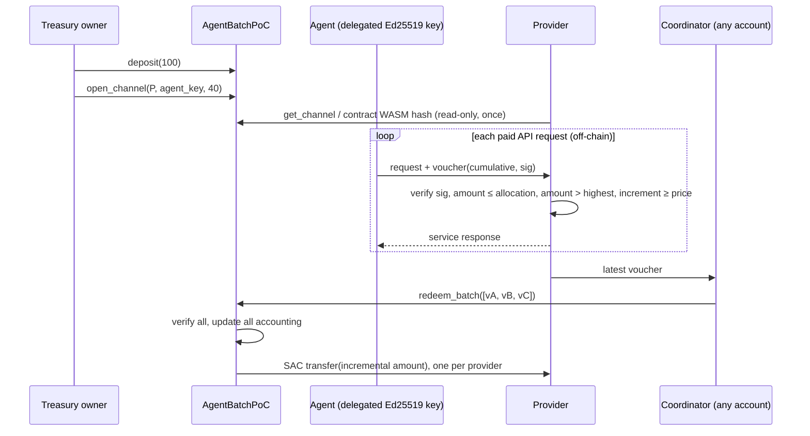

# PoC Architecture and Design Decisions

The PoC proves three things on Stellar Testnet:

1. **Shared treasury funding.** One deposit into one Soroban contract funds
   several providers.
2. **Independent virtual channels.** Channels are storage records with
   isolated collateral, not separate contract deployments.
3. **Batched multi-provider settlement.** Independent cumulative vouchers for
   different providers settle atomically in one transaction.

Anything beyond that (closure, revocation, rotation, reallocation,
multi-tenancy, adapters, console) is reserved for the grant-funded roadmap.

## Components

```text
contracts/agentbatch-poc   Soroban contract AgentBatchPoC (Rust, no_std)
packages/voucher           @agentbatch/voucher: voucher encoding, agent signing,
                           provider verification, highest-voucher store
apps/demo                  Testnet runner: asset issuance, deployment, three-provider
                           simulation, batch settlement, benchmarks, evidence
test-vectors/              Rust-generated vectors that the TypeScript tests must match
```

## Contract interface

| Function | Auth | Effect |
|---|---|---|
| `__constructor(owner, token)` | `owner` | Binds owner and token permanently. Runs once, at deployment. Requires a 7-decimal token. |
| `deposit(amount)` | owner | Transfers tokens from the owner; `available += amount`. |
| `open_channel(provider, signer_key, allocation)` | owner | Moves `allocation` from `available` into a new channel reservation; returns the channel ID (1, 2, 3, …). |
| `redeem_batch(vouchers)` | none | For 1–4 vouchers on distinct channels: verifies each, pays `amount − redeemed` to the stored provider. Atomic. |
| `withdraw_available(amount)` | owner | Withdraws unallocated funds only. |
| `get_treasury()` | — | Totals, actual token balance, unaccounted balance. |
| `get_channel(id)` | — | Provider, signer, allocation, redeemed, remaining. |
| `voucher_message(id, amount)` | — | The exact bytes to sign; used for cross-implementation parity checks. |

There is no initializer, setter, upgrade, close, revoke or rotate function.

## Storage

| Data | Storage | Key | TTL policy |
|---|---|---|---|
| `Config { owner, token }` | instance | `DataKey::Config` | Extended (threshold 7 days, to 30 days) on every state-changing call; this also extends the contract code. |
| `Treasury { totals, next_channel_id }` | instance | `DataKey::Treasury` | Same as above. |
| `Channel` | persistent, one entry per channel | `DataKey::Channel(u64)` | Extended to 30 days on open and on every redemption that touches it. |

Persistent entries are archived, never deleted, when their TTL lapses. Since
protocol 23, transactions restore archived entries automatically, so an
archived channel returns with its `redeemed` counter intact
(`storage::archived_channel_restores_with_full_state`). Replay protection
therefore survives archival. A missing key is always `ChannelNotFound`, never
an empty channel. Read-only views do not extend TTLs. Anyone can extend or
restore entries with `ExtendFootprintTTLOp` / `RestoreFootprintOp` without a
contract function.

The 30-day extension is the main cost of opening a channel (see
[benchmarks](benchmarks.md)). It is a tunable constant (`TTL_EXTEND_TO`).

## Settlement flow



`redeem_batch` runs in two phases. First it validates every voucher and writes
all channel and treasury accounting; only then does it make the token
transfers. A failure anywhere reverts everything.

## Design decisions and deviations

| Decision | Choice | Rationale | Relation to existing Stellar implementations |
|---|---|---|---|
| Channel representation | Persistent records in one contract | Shared funding with no per-provider deployment; this is the core claim | one-way-channel deploys one contract per funder–recipient pair |
| Collateral | Explicit per-channel reservation from a shared pool | A provider's claim cannot be satisfied with another provider's funds | one-way-channel collateral is the channel contract's whole balance |
| Voucher signature | Raw Ed25519 over XDR `ScMap`, verified with `ed25519_verify` | Long-lived cumulative commitments do not fit Soroban auth entries (nonces, expiry) | Same mechanism and encoding style as one-way-channel commitments and MPP |
| Voucher fields | Adds `channel_id`, `owner`, `provider`, `signer` | Many channels share one contract address, so the channel must be bound explicitly | one-way-channel binds only domain, network, contract and amount |
| Redemption auth | Permissionless; payout recipient comes from storage | A coordinator can settle many providers without collecting their signatures | one-way-channel `settle` requires `to.require_auth()` |
| Stale voucher | Error (`StaleVoucher`), not a no-op | Makes replay attempts explicit; the spec requires rejection | one-way-channel transfers nothing and succeeds |
| Over-allocation voucher | Error (`ExceedsAllocation`) | A provider can never be paid beyond its reservation | one-way-channel is bounded by the contract balance |
| Batch size | 1–4, distinct channels | Bounded, measured resource use; duplicates rejected | — |
| Token | Fixed at construction; 7 decimals required | Exact AUSD base-unit accounting | — |
| Unsolicited transfers | Never credited; reported as `unaccounted_balance` | `available` changes only through `deposit` | one-way-channel counts direct transfers as top-ups |
| Upgradeability | None | Out of PoC scope; immutable code is simpler to review | — |

## Off-chain components

- **`AgentSigner` / `ChannelSpender`** hold the agent's raw Ed25519 key and
  issue strictly increasing cumulative vouchers. They refuse to sign beyond the
  allocation. Agent keys are not Stellar accounts and hold no treasury rights.
- **`ProviderVerifier`** accepts a voucher only if it was signed by the
  registered signer for this provider's channel on the pinned contract and
  network, stays within the allocation, exceeds the highest accepted or
  redeemed amount, and covers the request price.
- **`assertTrustedDeployment`**: before reading any channel, the provider
  checks that the contract's on-chain WASM hash and payment token match the
  pinned values.
- **`FileVoucherStore`** keeps the highest accepted voucher per channel and
  writes atomically through rename. Requests in the PoC are sequential;
  production needs an atomic compare-and-set store.
- **Coordinator**: any funded account. It simulates `redeem_batch`, then
  submits it. It holds no treasury rights.
